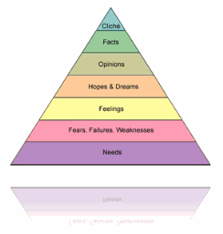

***A common theme this week among friends; Relationship(s), The Chase & Defining Roles ... my personal thoughts were of not missing the responsibility or accountability of being in a relationship but missing intimacy. I remembered this post & I haven't written in a while so it's relative ... two birds, one stone.  ~Brian***
Originally Posted May 16, 2010 @ 9:29 P.M.

I ran all up on a book the other day, ‘cause it was sexy! I mean this book had a “tramp stamp” in the small of it’s back that drove me crazy! As I spit my game, trying to get it’s math I realized that it was very interesting how she broke down intimacy.

“The Seven Levels of Intimacy: The Art of Loving and the Joy of Being Loved” By Matthew Kelly

The book breaks down the process of revealing our authentic selves while our “representative” takes a step to the back.

Before you go back to Twittering, Facebooking or picking your nose, this is not a book review. If you wanna know more my brotha’s and sistah’s, you’ve got to buy your own! I ordered a hardback copy from Amazon for under $10en. 99. The book itself was $Free.99 but with shipping & handling the BIG A got me.

Whether consciously or subconsciously we all have our own personal levels of connection or “In-To-Me-See”

Like: “You like me!, You really like me!” … Butterflies, text messages, emails, parking outside their homes in a friends car so they don’t see you, talking & laughing for hours learning each others personality.

Love: Love is “like” to the ‘umptenth power, moving from a physical reaction to a chemical reaction. {Remember? From [Seeing Clearly](/unknown-black-male-1/2009/08/26/seeing-clearly) … Physical vs Chemical: in a physical reaction two substances are mixed or ground together without being transformed, meaning both can be recovered from such a mixture in their original state. A chemical reaction, on the other hand, produces an entirely new substance, one that is very different from either of the reactants and does not easily yield the original substances back again.} Science! This is the move from the growing in your groin (Lust) to dreams of you growing old together tweezing each others nose & ear hairs.

Trust: We all have our own definition of trust, but let’s be clear, at this level it is not that high-school game of who cheated on who. You should feel trust … it’s about protection, feeling secure knowing that someone will protect your heart.

Respect: R.E.S.P.E.C.T.  … Find out what it means to me. Another word with broad interpretations, levels and degrees. To me It is about understanding each others value, value as a woman, man, human being who drinks water and breathes air, never wanting to disappoint or have that value depreciate.

Honor: This is the deal closer, a virtual badge signifying your commitment. Ultimate understanding of who we both really are. Accepting & protecting all of the like, love, trust and r.e.s.p.e.c.t. that we have for each other.

There are many others I’m sure that could be added, however, this is my list … you’ve got to tell me yours. What are your levels of connection?

P.S. While you are working on that can someone tell me why we stopped using “Obey” in wedding vows? I think if we add it back in there women won’t be so out of pocket, so beside themselves.

Word,

Mr.”You promised to obey, now go in there and fix me a sandwich” TramueL
