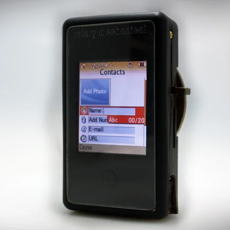

3

Random Observation About Nothing #1

High on my list of annoyances are failing to acknowledge folks or over thinking an acknowledgement. I’m not sure what is more annoying; Someone looking down at their phone, looking at their watch, eyes down at their feet all to avoid making eye contact and part their lips to speak  or speaking to a woman and she receives it as an attempt to lay horizontally while making animal noises.

To help those that seem detached from common courtesy and in most cases common sense, I’ve included a list of ways to respond when you see folks that you interact with on a daily basis. I wouldn’t encourage these behaviors on the city streets.

**Make Eye Contact***Smile with your eyes*

**The Fabled Nod of Acknowledgement***Up down or Down up, your choice*

**The Compliment***Be sincere, even if you have to fake it*

**The Wave***Whatever you do be a man or woman about it, no transference*

**The Smile***Nothing is more inviting than a nice set of teeth & a warm mouth*

**The Hug and or Kiss***No air kissing READ: Women only, I prefer my kiss on the lips & keep your booty close on the hug, which leads to the …*

**The Booty Smack***Bad Boy Baby #TakeThatTakeThat*

**Mr. “*Holla when you see me*” TramueL**

Photo Credit: [Richard Clarkson](http://www.flickr.com/photos/clarkson_richard/5838937844/in/photostream)
