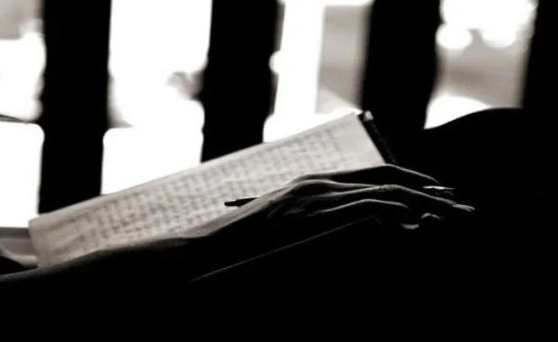

Note(s)

Not So Random Observation About Everything #1

Saturday  provided an opportunity for me to *shift Seeking His Information For Transformation* … I lost my wallet with checks, cash & cards inside. I’m pretty adept at staying positive when negativity approaches but fail over analyzing the situation searching for a lesson. The energy I emitted must have automatically or instinctively drawn others to me. *Read* My energy was not spent on the loss or of feeling sorry but looking for a lesson; God is trying to tell me something? … the items can be replaced and the act of losing them would prove to be irrelevant days later. I told two people that day, two that I trust. What they provided were words of encouragement, and space for me to pull up my strength.

Concerning connections and energy … I received an instant message from my sister in faith and a text message from The TramueL Formerly Known As two days later. I had not spoken with either about losing my wallet.

**Of The TramueL Formerly Known As**

… Our relationship is absolutely unique, just like everyone else. Her concern is usually shown by commenting on my shortcomings so to receive the following message was proof positive of a positive connection.

*“**Good morning, jus woke up with u on mind. Everything ok?”*

**Of My Sister In Faith**

… I can’t explain how important this person is to me, she keeps me grounded in faith and she counsels from the word of God.  Her greeting made my heart smile.

"*There are just some people you love and distance never separates you and because you are on my heart it only means that you are on God's heart."*

C.S. Lewis often referred to this human connection as “kindred soul” people seeking the same truth or more specific, care about the same truth. We should all have someone with an S on their chest. Your friends should not want you to stay as you are but encourage you to seek growth, be all you can be.

~ Brian
