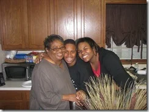

*Ahh Age* *The one thing I find about aging is that the older you get the faster time passes. Although I never was one of those teenagers that wanted to hurry up and be 16, and then 21. It was probably because I had to grow up quickly anyway. But with each passing year I realize that life is good. I wouldn’t go back and change anything because I learned some most valuable lessons, although the lessons beat me up a time or two, I am stronger because of them. I learned patience, resilience, how to recognize true love, and most of all I learned me. I embrace my golden years and thank God I’m still here. I have lived long enough to see my children grown and to enjoy my grandchildren. I have been blessed by age for it has given me so much to be grateful and thankful for. Aging has allowed me time to forgive and forget, and to move forward without regrets but hope for better things to come. We have seasons of our lives and I am in a good season now and I will reap the harvest with much gratitude. With each plentiful harvest I will share my blessings with my family and those around me. Aging has allowed me to understand what is really meant by “it is better to give than receive” it puts life in perspective when you give and give from your heart. You can only learn this with time that comes with age. Brian did say a “short” story or paragraph, so I will end with this, take nothing for granted, don’t assume anything, and take life one day at a time and let age do the rest.*

*Walk in your blessings.*

*Happy Birthday, love Mama*

*Nona Wallace - Brian’s Mom - I love you “Bae Bae”*

Mom\_Aaron&Dorian
