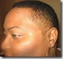

*40 Years...**I'm not sure how I feel about turning a year older this year. I'm still trying to process my feelings. On my 33rd birthday, I remember lying in bed trying to cope with the fact that instead of spending the weekend in sunny L.A. at the Blogging While Brown Conference, I had just buried my mother three days before. The thoughts of the trip were secondary to the fact that my mom wasn't there to tell me happy birthday. What a birthday!*

*I thought about all the times I took her "Happy Birthday!" calls for granted. All of the times she let me know that she didn't buy me anything because she didn't have a clue of what I wanted, but I could take her Sears card to find something suitable.  Every year I declined because I didn't want the stuff--a closer relationship would have made my heart content.  This year I wished she was around so that I could tell her that.*

*So I would have to say that this year, my 33rd year, I learned that the saying, "Live everyday like it's your last day." is not just cliché.  Sometimes things come along and shake our foundation helping us realize that life is so much more that the minutiae we fuss about daily.  My mother and I spent over half of my life bickering.  It wasn't until my mother lay on her death bed that I understood that the problem we had wasn't really "our" problem.  She was just a women who loved a man who didn't want to be loved.  I was the result of that union and a constant reminder of her love for him.*

*These days I spend more time thinking about relationships.  I refuse to be a hurt person who hurts other people.  So I love hard.  I nurture all of my relationships and when I'm not treated how I want to be treated I don't linger...I just let go.  In her own way, my mom taught me it's okay to let go and that it's okay to love. This birthday I learned to say, I love you freely, without reservation.  God forbid I leave here anytime soon but when I do there will be no question as to how I feel about the people in my life.  Yep, my mama taught me that in her own little way...*

*I spent my entire life waiting for my mom to tell me she loved me.  She finally did...on her death bed...In my heart I know she always did.*

spinks sideview
