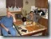
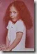
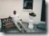
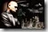
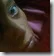
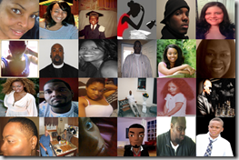

Thank you to everyone that shared, commented, cried, laughed, loved, liked, prayed, shouted, counseled, tweeted, stumbled, posterized, tumbled, facebooked, emailed, plusoned, texted & reshared. It was an amazing display of emotion, value, personality, love, life, passion, ardor, desire, spirit, art, energy, reality, color, family & charm.I appreciate  each and everyone of you.

Magic Always …

Mama & Johnny

*“… take nothing for granted, don’t assume anything, and take life one day at a time and let age do the rest.”*

*N. Wallace*

Kari

*‘Something happened on the way to 30,* *Weight Watchers called “We have the solution”*

*“Something happened on the way to 30,* *The switch in my hips turned into a limp”*

*“Something happened on the way to 30,* *The pretty complexion became mole central* *(Party up in here! Moles stay #winning!)”*

*“Something happened on the way to 30,* *Afternoons spent thinking “Did I take my medication?”*

*“Something happened on the way to 40,**I finally stopped caring about my age…”*

*BlaQ Daisy*

Dear Yvette

*“And everything you have can be stripped from you in the blink of an eye. So my new stance on life is this: LIVE, LOVE, LAUGH, and make yourself happy, regardless of your age. Man up or put on your big girl panties (whichever applies) and live with NO more regrets. 40 is my new 30.”*

*A. Waters*

L. Delli-Santi

*“What is really important, and often overlooked in the grand scheme, is that your past and the obstacles that were hurdled will always be a beautiful part of you.”*

*L. Delli Santi*

D. Dorce

*“As i reach another year i can only feel closer to achieving those goals, that aspect in my life of fulfillment, of achieving, of finally resting on that i am who i was meant to be and more, and able to share that with someone special.”*

*D. Dorce*

Young Cyn'

*“The older I get, the more I realize that there will come a point where I… we.. will age no more. But we can still live on.”*

*Cynti’*

Ms.Nikks

*“I allowed myself to remember that there’s so much in-between birth and death. So much living to be done and I got back to the place I was before turning 25.”*

*Ms.Nikks*

T. NG

*“I love getting my hair wet in the rain, singing love songs and not worrying about being perfect. I’m excited about thirty because I’m going in as a woman who loves works and plays hard. You are always more blessed and beautiful than you think you are.”*

*T. Ng*

Will

*“I had a great life in the past. I enjoyed my early youth (hey, I think I am still in my youth)! But in order to truly gain and appreciate the gifts of age, you have to embrace it. And with that, **I EMBRACE MY AGE**.”*

*Willie Stylez*

W. Tisdale

*“Now at 41, I think Tina Turner and Sidney Poitier are awesome. I used to think if I earned $50,000 I’d be rich as hell, then I reached that milestone and the folks at Discover Card wouldn’t leave me alone.”*

*W. Tisdale*

J. Francis

*“Now with age I see purpose, legacy, meaning in movement. What do I stand for? The truest values of life now run through my head as I navigate the current storm of change that is this nation.”*

*J. Francis*

Citizen Ojo (2)

*“The college years were the beginning of adulthood. It was a time of reinvention and self exploration. I was coming into my own and was figuring out who I really was.”*

*Citizen Ojo*

Jennifer

*“As I looked back at my past year I was amazed at my growth and how far I’d come. Slowly I was able to find my place in the world as an adult. I could stand on my own two feet and with that I found my strength.”*

*Jennifer*

Inspired Enigma

*“Aging is inevitable and I’m a work in progress. Some days a masterpiece; other days a disaster.”*

*Enigma*

Sunny

*“My advice: Don’t trip over age; just remember those who you’ve lost that never got a chance to live to see that day in their lives.”*

*S. Salter*

Lisa

*“…whether it’s late nights or early mornings, my time is my own, and I’m cherishing every minute of it.”*

*Lisa*

J-Up4Dsn

*So now it is time that you start looking at your aging as a wonderful thing. Enjoy the things that you can still do and be happy that you can no longer do the things you once did. Know that there is truly a reason for that. It’s time for you to love who you are and love **GOD** for creating you.*

*Jay*

spinks

*These days I spend more time thinking about relationships.  I refuse to be a hurt person who hurts other people.  So I love hard.  I nurture all of my relationships and when I'm not treated how I want to be treated I don't linger...I just let go.*

*Y. Spinks*

C. Black

*“Planning is only effective if action immediately follows. The best way to live is to embrace every moment and use and enjoy each one. There is not a rewind button.”*

*C. Black*

NewNew

*“The tugging in my body & soul over this past year wasn’t the anxiety of turning another year older, it wasn’t the thought of any failures or regrets, it wasn’t about not being where I believe I should be but it IS about needing to make an impact, knowing that my existence matters.”*

*B. TramueL*

R. Boyd

*“Every day you wake is a new day with new possibilities. If you are out of shape then it is time to hit the gym become a physically fit middle aged, body beautiful, temptation to your spouse or intended. A new mercy from God opens the door for better second half of your life.”*

*R. Boyd*

Mel'

*“There’s an allure to complete important unfinished business that at one time drove your daydreams and goals for they have not perished but simply waited for the right time.”*

*Melzie*

41 Years To Life
