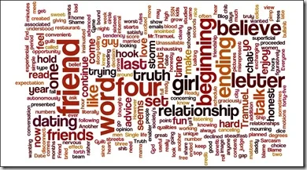

It’s been one year, two months, four days, three hours, sixteen minutes and forty-five seconds since my last relationship. I don’t believe I have an internal mourning period but there always seems to be a gap of a year before I roll the dice. **I Am**I Am … great at giving advice when it comes to matters of the heart. I believe that …

I Am … a four letter word beginning with L and ending with E enabler. However …

I Am … the worst at following my own advice concerning a four letter word beginning with L and ending in E.

**I’m Not Ready To Date**

This steadfast belief that I Am … not ready for another relationship came full circle last week as I had a friend that is a girl look to set me up with a girl that is a friend. I don’t believe it was really for my benefit as much as it was to satisfy my friends need to feel useful.

The show. Single women often ask their married friends to put them on to a few good men. Truth is if my girl that is a  friend truly knew me she may have understood that I am content with my life now; working on my relationship(s) with me, myself & I [collectively we], my kids and my God. There has not been one conversation between my friend & I where I have insinuated that it was hard out here for a pimp and that I was looking for love. Everyone wants you to do what is convenient for them. I should have said no, the most anointed word ever created. I believe one of my bad qualities is trying to keep up a nice guy image & wanting my friends to hold a high opinion of me. The TramueL effect proceeded with exchanging pictures, numbers, emails, SSN, credit score & blood type …

**Blame Game**

I have a tendency to misrepresent myself with what I say from time to time. I love to chat, enjoy story-telling, and sometimes enjoy bending the truth while listening to myself talk. I can talk up a storm when I’m nervous or excited & that’s usually where the disconnect starts.

Did ya’ll read up top where I tried to put the blame on my friend for not knowing me? Shaking my head, truth is it was clearly on me. I wanted to prove that Mr.TramueL is a come through guy not bound by the superficial rules of dating set forth by society’s edicts [in addition to talking up a storm, I like to hear myself talk.]

Another truth, I don’t feel like going through the motions. It seems more exhausting than fun to go through the who’s yo’ mama, who’s yo’ daddy … where did you grow up, what do you like to do for fun.  I’d rather come home & read about a four letter word beginning with L and ending in E from all of the people who studied relationships & hold advanced degrees and now Blog about it. /End Sarcasm.

**Unassailable honesty**

The hook up ended with me canceling a scheduled date at the last hour, shit judge me. My stomach was sending solar flares to my brain and vice versa. The anxiety I felt over eyeing the future, it wasn’t going to end well. I would either waste an extended period of her life trying to prove I Am that guy or I would make myself unavailable, leaving her with trust issues. I give myself too much credit I know & while I was honest about it being hard for me to get there; literally & figuratively the restaurant we planned to meet & dating. It all could have been so simple. I should have said no. No to the hook up, no to dating.

I presented her with a unique opportunity to be on The TramueL team as a friend that is a girl number 7. My point of view is that if I’m honest about where I Am it frees me from guilt. Guilt that would be associated with your decision to continue autonomously. Your choice to continue to share. Don’t make me make you fall in *Love* with a ninja like me.

With the expectation set that I wasn’t trying to D anyone down, I thought we would be free to move around these city streets. You know experiential schooling, some sweet late night chit chat, friendship. Friend. Ship. to which she graciously called bullshit declined.

The 10.15.11 Theory, pay attention to where you are now. Don’t trip over your shoelaces while eyeing the future.

I Am …

InfoGraphic
