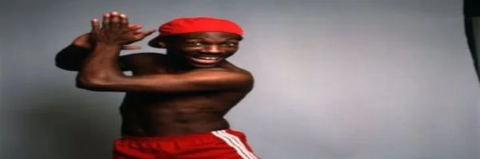

It’s heavy in these social streets.
**To use or not to use social media**

Build it and they will come. Use it to benefit you or use it for fun. Or, don’t use it at all. Your point of view means nothing to others. I’m not dope or vapid because I use it and you’re not profound or about that slow life if you don’t.

No applause.

**Knowing who someone is**

Nah kid, I didn’t write *knowing* someone. Folks feel special when they can say they know who someone is when the rest of us know little about them. This dude that married Kim Kardashian [I can’t believe I’ve immortalized this chicks name in a post] Kris Humphries, I don’t know who he is or who’s vagina he came out of but you do, and that makes you pop savvy and culturally relevant? Don’t answer ya’ll know the rest …

No applause.

**Personalized Appearance Choices**

You rock a Mohawk, an afro, braids, bald, Jeri-curl or natural? Tatted up or your body is a temple? Latest fashion or Wal-Mart brand? Good for you. Unless it is your inner circle or folks that care, you gets no love. These are highly personal choices that have nothing to do with the well-being of others.

Do you, but no applause.

**The Car you drive**

Posted up next to your Toyota Prius or your Porsche Panorama, my point of view is that you’re both winning. But before you get to hand clapping, don’t. Both of these owners seem aware, waking up to the joy and positive significance of each moment. One is aware of green living & the other is living with a lot of green.

No applause.

**Where you bank**

We are living in the worst economic downturn of our lives. Banks are beginning to pass along more cost to the consumer. There is nothing wrong with tweeting, blogging or updating your status with your preference if you realize your place. Delight & teach about the benefits of a financial institution but demanding that someone switch to another institution or a credit union so that they can earn 0.8958272356452% interest on the $150 average daily balance they carry doesn’t deserve a church clap. This doesn’t make you smarter just misinformed. No toaster for you

No applause.

**What you listen to**

Word? You only listen to conscious rap n\*gga? Oh, my bad that word probably offends you. Word to life you are deep son. Not. Nobody cares. You are entitled to your music choices but listening to or not listening to a particular music genre doesn’t get the lighters in the air. No soup for you wack n\*ggas

No applause. ::Rick Ross Grunt::

**D\*ck riding**

Literally & figuratively.

Literally, you have threesomes & unbridled sexual pursuits. To quote a fellow blogger “Everyone is talking about sex but no one is good at it” Ouch. I applaud you for being liberated. Whether you’re running a train or you’re celibate, no one cares. Sorry. However, If you riding that train wrap it up ‘cause you don’t want that late text that I think I’m late text.

Figuratively, get off of these twitter famous girls & guys jocks re:tweeting, re:posting and just re:ing all over the place these intuitively obvious quotes and pithy sayings. If I wanted to read their tweets I would be following them. Fuck a quote tell me what you know. As Daisy would say “reading comprehension” … tweet what you got from that quote, if you can’t then I sentence you to remedial English.

No applause.

**Where you from**

Chi-Town, The Boogie Down, Killa Cali, ATL, DMV, BIG Lick! [Wait. Who?] … Stand up! No. Sit back down. Simply being born there or currently living there doesn’t make you a better person for it. Seems a bit ethnocentric don’t you think? Man don’t answer. It was rhetorical.

No applause.

**Taking care of your kids**

Folks always want credit for what they are supposed to do.While you deserve applause for taking care of your kids, inherently you do not. We all dote on our kids and we are proud of their accomplishments, just because you have to take time from your job to take little Johnny to the doctor doesn’t mean you deserve an award for parent of the year.

Give it to em’ Queen! I’m about to. That’s what you supposed to do.

No applause.

**Being Mr.TramueL**

Great! You’ve tweeted articles to Hip others [make aware of & influence by the thoughts & ideas based on social, economic & cultural background.] You equate re:tweeting with giving back. How about getting involved? Even if it starts with social media, end it with action. Stop *trying* to inspire, you don’t deserve applause for it. Just do it, live authentically, show interest for folks emotions /values and continue to exchange and share.

Hip somebody. No applause.

I Am ...

Mr. *“You can get with this or you can get with that, I bet you get with this ‘cause this is where its at”*  TramueL
