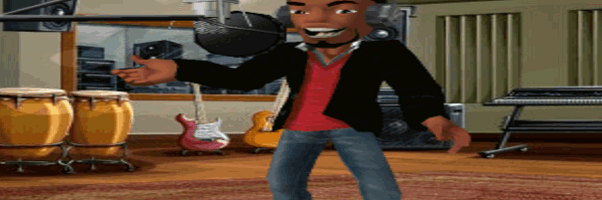

I’ve expressed my love for music & ya’ll know I’m a bit kooky. I often relate things happening in my life to the music I am listening to. While it is not specific to the songs lyrics or meaning; a phrase, a verse or the hook may spark a thought. Life set to an album track listing. Al B Sure, In Effect Mode.

***"Nite and Day"***

*Nite & day* represents time. There are twenty-four hours in this cycle, time is our most valuable asset. We can work & earn mo’ money. We can find a new person to love & as the song’s lyrics suggest, proclaim said love nite & day. Currently folks feel entitled to my time and my love. Don’t do that, I dislike personal entitlement.

***"Oooh This Love Is So"***

Oooh, this four letter word beginning with L & ending in E is so … While I am not presently searching for it, I Am in love with thoughts of how she thinks, sounds, smells, looks. My thoughts are greater than actions at this time however, my actions in a four letter word beginning with L & ending in E tend to promise deep commitment.

***"Killing Me Softly”***

I’m for saving the dolphins, the ozone layer, green living & alternative fuel but folks presenting their behaviors & actions as being one hunid’ percent positive all day is killing me softly. There are days that I curse, spit, drive over the speed limit & want to beat someone all about their face. We are all human, my god it must be hard tweeting, posting and spreading perfection all day. Live truth instead of professing it. #SixWordStories

*“All of us have dirt under our fingernails from time to time. The dirt, along with your great acts, is what makes you a beautiful human being. There’s not one person on this earth who’s **all** positive.”  - Common*

***"Naturally Mine"***

Weave. I’m trying to understand the point of weaves & wigs. Clearly I Am in the wrong business because the majority of folks in my business appear to have hair that is unnaturally theirs. I think the point is to make it look as natural as possible but I’m finding it hard to believe that a South Charlotte resident has fine, luxurious, premium Indian hair. I suppose she could, we all have Indian in our family/  My hair is naturally mine as is yours, you paid for it. I’m not against weave, just bad weaves.

***"Rescue Me"***

I try to remain detached from conversations about love [save a few friends] but this is a constant source of discussion among everyone. Every. One. To rescue [me]n & wo[me]n, we have to seriously rescue love from the abyss that is romance. I’m not against romance, however I believe we have to stop being in love with the *ideas* of love. Friends describe their ideal situations all of the time, stop looking for someone to rescue you, that knight in shining armor is a fairytale. Shit is real.

***"Off On Your Own (Girl)"***

“Let’s be friends or else!” I recently deactivated my Facebook page, I could offer a few scenarios but the main point is that I was rarely on there. The only exceptions being oversharing of my blog[s], foursquare check-ins and the occasional tweet. & just as I imagined the world didn’t end, none of my true connections were impacted as I still have ways to communicate with them through my blog, twitter, email, text, gChat … I did receive a few disturbing emails from someone who wanted to know why I unfriended them, sorry boo you’re gonna be off on your own [girl].

***"If I'm Not Your Lover"***

Just because it is public, doesn't mean it is my business. I’m amazed at why we care so much about the lives of celebrities or the lives of others concerning their *private times and the whole nine*. If I’m not your lover I don’t care to know about what makes your sneaky a little freaky or vice versa.

***”Just A Taste of Lovin'”***

As we move from Fall into Winter folks are searching for the [Winter Boo](https://www.tramuel.com/iam/2010/12/05/get-a-boo-in-your-life/). Don’t accept any ole’ offer for a taste of lovin’; my experience has been that it ends up being too hot & you get burned or it is not enhanced with enough flavor. Let that marinate.

Any of these titles speak to your life?

I’ll B TramueL
