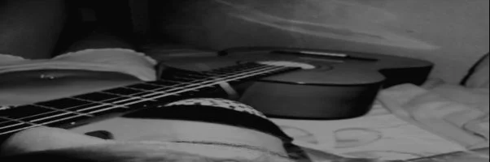
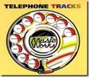

Telephone Tracks (1991)
It's the summertime & I Am sitting on the front porch as “cars ride by with the booming system” I remember the heavy bass & structure of the song(s) of this album. The Suzuki Samurai would take its place in a line of automobiles that set trends every summer & everyone followed. You could hear & feel the kick from the sub woofers two or three blocks away, the “riddim” was one that I never grew tired of.

The theme of the album was simple; one song, multiple artist. Friendly artistic competition perhaps. I just allow it to play through …

**Life set to the songs of Telephone Tracks.**

[Telephone Love](http://dl.dropbox.com/u/2869333/06%20Telephone%20Love.mp3)

There is nothing sexier than the sound of a woman’s voice. Combine that with great conversations about nothing yet everything & I’m ready to propose marriage. My first “telephone love” & I were able to appreciate the beauty of the natural world without our individual passions or possessiveness getting in the way.

[Everyone Hustling](http://dl.dropbox.com/u/2869333/07%20Everyone%20Hustling.mp3)

*“Things may come to those who wait ... but only the things left by those who hustle.”  - Abraham Lincoln*

Don’t exhaust yourselves trying to keep up with the Jones, most importantly be aware of your effect on others. If your main focus is building a [insert brand, business, empire for world domination or the things you are hustling for] take great care not to lose sight of the loved ones for whom you hustle.

[Street Talk](http://dl.dropbox.com/u/2869333/08%20Street%20Talk.mp3)

This is relative but not reflective of street talk per say, but I always laugh when we “switch up our flow” to suit whomever we are talking with. We have that corporate milk flow for work, the I’ma show you where I’m from flow with our homies  & the baby I just want to see your panty drawz  flow for the ladies.

[Lonely Night](http://dl.dropbox.com/u/2869333/09%20Lonely%20Nights.mp3)

Speaks for itself.

[Sweet Ecstasy](http://dl.dropbox.com/u/2869333/10%20Sweet%20Ecstasy.mp3)

The concept of ecstasy is to step out of yourself. Of the drug, I sense this means having the ultimate experience, high for this. Scientists claim that beauty can induce pure pleasure in the beholder. I find beauty in books, music & women [not necessarily in that order] these are my drugs they get me high. Science is true.

[Nuff Respect](http://dl.dropbox.com/u/2869333/01%20Nuff%20Respect.mp3)

"Respect the Shooter" - Hank Willis Thomas

Basketball & Chain HWT

[Choice](http://dl.dropbox.com/u/2869333/02%20Choice.mp3)

*The voluntary act of selecting or separating from two or more things that which is preferred; the determination of the mind in preferring one thing to another; election.*

In this song one of two male suitors asks the woman which one she will choose. I’m talking about the lyrics to this song because this helps me explain why I shy away from talking about romantic relationships. Love is often viewed as something a woman gives to a man & as something we are entitled to have. I Am a four letter word beginning with L and ending in E enabler, I wish we would change the conversation.

[Snacking](http://dl.dropbox.com/u/2869333/03%20Snacking.mp3)

No profound thought here, although I have been snacking on these Brookside Dark Chocolate Covered Pomegranates. You really should get like me.

[Heavy Load](http://dl.dropbox.com/u/2869333/04%20Heavy%20Load.mp3)

These days find us all searching for peace in the midst of turmoil. I’m always amazed when I think about how much strength we posses as a people, I’m encouraged by the millions of situations in our lives where we have to call upon that strength knowing God carries the bulk of the load for us.

[Single Life](http://dl.dropbox.com/u/2869333/05%20Single%20Life.mp3)

This is a gift & an opportunity for me. Although I appreciate these private times & the whole nine, there are times that I seek more meaningful emotional interaction.

telephone-tracks\_thumb.jpg

I Am ...
