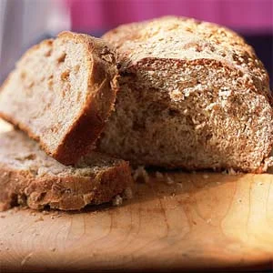
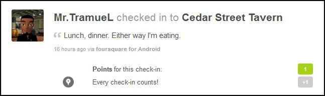
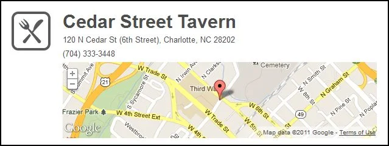

# Chicken Salad on Wheatberry

Repost from Dec 18, 2011 - I wanted to write about food so I Am recycling.

Mr.TramueL. Check in @ Cedar STreet Tavern

Food for thought.

Sat down at the bar inside of Cedar Street Tavern to order lunch, incidentally I had a small garden salad with honey mustard dressing and a chicken salad sandwich on wheatberry bread with a side of fries. I do it.

Flanked by televisions & windows on either side of me, I fix my eyes on the view up and to the front. Stephen A Smith looks animated as his mouths moves and hands gesture. It looks as if he is following one of my very own moves; give up conversation, but don’t say nothing. All of that to say there is no sound coming from any of the televisions. I drop my gaze to a large window with a clear view of 6th street ... [break]

I've worked Uptown Charlotte for a little over a decade in one capacity or another; Center City or presently here in The Gateway. I've observed restaurants open & close, businesses open & close, and new buildings go up & fill up. So I Am aware out here in these City streets or so I thought.

[& back] ... across the street I noticed a building that has clearly eluded me for the past decade. I promise you that I had never noticed it or its occupant The Urban League of the Carolinas, if you asked me what's on the corner of 6th & Cedar you would have made me cuss trying to convince you that it was an empty lot.

Cedar Street. FourSquare

Every day we rush; rush to work, rush to school, rush to drop off / pick up children, rush to the gym, rush to prepare dinner, rush to get in the bed so that we can get up the next morning and repeat. We've become so caught up with rushing that most of us believe if we are not constantly in motion that we are unproductive and in turn not improving our lives. I'm learning to recognize these moments as gifts, so much so that I wrote this on the back of a few bar napkins. I'm learning to be more objective about myself and less critical of others. I'm learning to stay alive in the moment. In learning to step outside of myself and become an observer, these not so random observations become opportunities to improve.

**Don't lose sight.**

*"Things may come to those who wait, but only the things left by those who hustle."* ~ *Abraham Lincoln*

Don't lose sight of those for whom you hustle, the personal side of your life may be getting lost in the rush.

**Slow down.**

*"Drive slow homey, Live today cuz tomorrow man you never know..." ~ Kanye West*

Slow down, take notice of the scenery, architecture, people, beauty, growth, change and progress along your journey.

Live Well,

I Am
