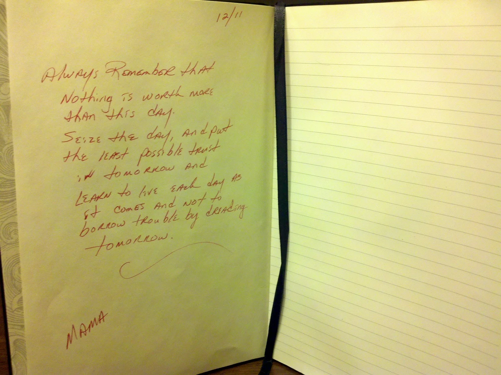

This Christmas I received a set of journals from my mother, I took one to work with me because I want to use idea maps and journal-writing to take inventory of my not so random observations and everyday situations ... but some other time for that. This post is about the awesomeness that is my mother.
I open the journal to start writing, I notice the inscription & after reading become completely enamored ...

*"Always remember that nothing is worth more than this day. Seize the day and put the least possible trust into tomorrow and learn to live each day as it comes and not to borrow trouble by dreading tomorrow."*

 I immediately send her an email thanking her, exclaiming how awe inspiring her words are & that I loved her. My email was followed by an even more powerFULL message ...

*"When you journal, just make sure that the words will feed your spirit and comfort your soul. Allow your journaling to be a release and relief source for whatever is on your mind. There are two people who you can always talk to if you ever feel the need to get things off your chest, but somewhat uncomfortable about sharing some of your most innermost thoughts and feelings. These two people will not judge, criticize, speak harshly to you or say hurtful things, you will never intrude on their time, you will never be short sided or ignored. You can always find them available. Take full advantage of them, for they won’t mind. The two people are God and yourself, through your journal. But you can always call on me too if you ever feel the need to talk about anything, I will never hurt you and I will only give the best advice that I can. And have fun with your journal too, let the light side of life be memories worth writing about, ones you can go back to for a laugh or a smile, for that feeds your spirit."*

Yeah, I know.

I Am.
