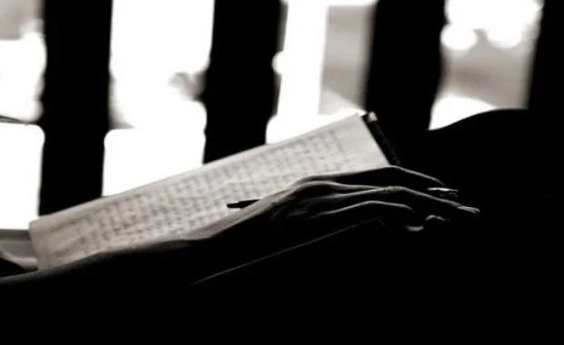

RE:Post [February 12, 2011]

**Deception**

We deceive and then we deceive about the fact that we deceive.

**Voice(s)**

There is a quiet, sensual power in a woman's voice. To hear her speak fills my heart.

{Posted as a Facebook status}

**Book(s)**

I know you all have heard me mention Kirk Franklin’s **[The Blueprint A Plan for Living Above Life's Storms](http://www.kirkfranklin.com/blueprint)** fifty-eleven times, well here is the fifty-twelfth time.  The blogosphere & media are engulfed with the singledome & singledoom of you coloreds. You also know that I try to look at the “why” instead of offering my point of view, even though I’m right ninety-nine point nine percent of the time. If you know & understand the “why” you can solve your own problems & that’s exactly what Chapter’s Six through Eight do for singlehood. “Mr.TramueL? You’ve got to let me hold that book!” Noooo my brother(s) & sister(s), you’ve got to buy your own. No excerpts, however the titles alone offer insight …

---

Chapter Six – If You’re Single, Make Some Noise

Chapter Seven – The Blueprint for My Soldiers

Chapter Eight – The Blueprint for Adam: Men & Sex

Chapter Nine – The Blueprint for Eve: Women & Sex

---

I’ve also recently finished *Practical Intelligence, The Art and Science of Common Sense* by Karl Albrecht & *Native Son* by Richard Wright. Yep, because I wanted you to know. Mr.TramueL is a bibliophile. I love everything from her smell to the way the crease in her back leads to her bottom … wait, never mind.

**Dream World(s)**

Keeping your eyes wide shut. Focus on seeing things as they are, not as you want them to be.

**Independence**

Sometimes we’re too dependent on ourselves and our own strengths.

{Shout out to God}

Mr. *Reconciling the Material & the Spiritual* TramueL
