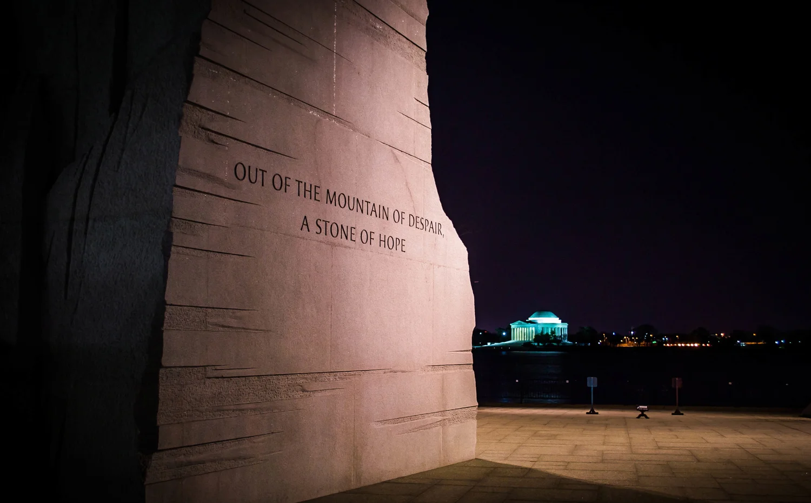

**Hope.**

Lately I’ve been surrounded by a nervous energy that is pretty easy to explain. It feels as if every person that I am in contact with is fighting some kind of battle. One glaring example, the part-time job that I’ve worked for over eight years is shutting down in September. I think about others for whom this is their only source of income. How working those hours affords them the opportunity to be available to their families during the day and in the evenings to kiss them goodnight. I pray they find something sustainable.

Things that give me hope.

**My family.**

I think about a recent conversation with my mom where we talked about politics and movies. I think about conversations with my cousin who will shoot first and ask questions later but is driven to the point of no return. I think about conversations with my sisters, their stories encompass sacrifices and triumphs in nurturing their own families. We are all absolutely unique and yet the same.

**My kids.**

I’m swelling with pride even as I write this, I think about where each of them are at this particular stage in their lives; rich in opportunity and nurtured with prayer.

**Genuine friendships.**

Taking an active interest in each others journey, even across the distance of times apart catching up as if the connection were never interrupted.

**Music.**

Music in the morning to start my day, music in the car / bus / train to work, music while at work; music is like medicine for me and amidst a stressful world, maybe I like a little extra medicine.

**The Sunrise, The Sunset & Full Moons.**

Literally and figuratively. The beginning of things, I appreciate the freshness of experiencing something new. The ending of things, I appreciate the opportunity and any gifts received. I appreciate the eye-catching, spiritual nature of all three.

It goes without question that **faith** gives me hope.

What gives you hope?

I Am.
