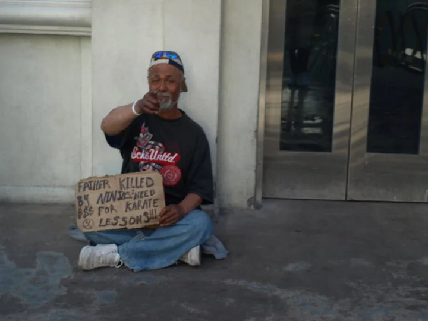
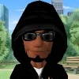

**Exposed:** Uncovered and therefore visible or without protection. Vulnerable to physical or emotional injury.

**Sheltered:** Protected from the unpleasant, upsetting, or testing experiences of life.

**Pre[R]amble**

I always feel like I need to explain the infrequency of my post. It usually has to do with the fact that I take in much from my environment, searching for some hidden truth or meaning. Swinging between irrational and rational thoughts and feelings [my crazy], normally this takes place in my mind but those close to me may witness it from time to time. The monotony of my life doesn’t provide many truth seeking moments and the tedious repetition of work, work, hustle & home leaves me uninspired at times.

I Am aware but detached from the current conversations that dominate my social feeds; money, sense of self-worth, basic values and personal possessions. As I listen to the undertone of those messages & those of my close friends it translates to “certain unalienable rights.”

**The Constitution**

We hold these truths to be self-evident, that all men are created equal, that they are endowed by their Creator with certain unalienable Rights, that among these are Life, Liberty and the pursuit of Happiness.

Word.

I Am witness to this pursuit for many, especially those closest to me. Their journey seems to further break down to a four letter word beginning with L & ending in E and Security. Read. Vulnerable, feeling susceptible to emotional or physical injury.

**Of Love**

Man, this right here. From my point of view, seems like flies on the windowsill. Those on the inside trying to get out and those on the outside trying to get in. Some other time for my contribution to the conversation of love.

I said some other time man.

**Of Security**

Man, this right here. Whether it be our career, relationships or walking home from a neighborhood convenience store, we want to feel assured, free from fear or doubt. This post is inspired by my own false sense of security while exiting my car heading to the building that holds my space in cubicle nation.

Actor Portraying Homeless Man -\_-

“ Excuse me sir, I’m trying to get something to eat.”

Mr.TramueL

“Man, I have only enough cash to pay for my parking.”

Actor Portraying Homeless Man -\_-

“I don’t want cash.”

***Pause.***

At this point I stop messing with trying to gather my things. Its at this point that [my crazy] takes over, you see I’ve played this scenario out in my mind a thousand times. This fight would be beautifully choreographed, I would fast forward the action in my mind just like Nathan Algren when confronted by the crew attempting to take his life in The Last Samurai. I was excited, anxious, nervous and maybe for one second fearful, but that fear quickly turned to fearlessness.

***Play*.**

Me [as I turn to face him; he pulls the hoodie off his head to reveal his stone cold face, hands in his pocket, I witnessed a life of misery behind his eyes]

Mr.TramueL

“What is it that you want?”

Actor Portraying Homeless Man -\_-

“I’m homeless & haven’t eaten in a few days, like I said ... just trying to get something to eat.”

Mr.TramueL

“Oh." [Security level downgraded. My crazy leaves.]  "If you don’t mind walking I can buy you something from the grill up the street.”

***Stop.***

**Reflection**

Whether in matters of the heart, walking from a convenience store or exiting your vehicle, we are all exposed. I pray that you are sheltered.

I Am
