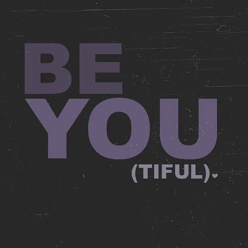

Inspired by a post on [The Good Men Project](http://goodmenproject.com/men-over-50/7-things-i-find-attractive-in-a-woman-now-that-i-am-50/), motivation by [Melzie G](https://plus.google.com/u/0/101737854888150090944/posts/9wZjzF1zLk1)
S.E.X. We can associate just about anything with sex and for good reason. This three letter word is what separates what I found attractive in my twenties and into my thirties to what I find sexY and attractive now. I’m not just referring to the “release” but also our experiences, which in turn have *released* some of the most powerful feelings we will ever know; pleasure or pain, anticipation or dread. My progression, transformation takes me from pursuing, awareness, relating, committing and finally maturing.

**Intelligence*****.***

Man listen, I consider myself pretty smart & knowledgeable about a few things so while I’m open to others point of view I secretly feel that I Am always right, you know at least 99.9% of the time. What I’ve found is that’s not exactly accurate more like 99.94% and I have been blessed with some highly intelligent women that are skilled at not only *not* bruising my ego but also changing my point of view & I have a pretty BIG ego.

**Passion.**

My experiences, my observations & my life have shown me that when women find themselves; understand their purpose and power they speak with so much strength, honesty and wisdom. What an emotional experience.

**Nurturing.**

This instinct is inherent; whether she is a mother or not, this can be an incredible source of support and encouragement. Not only are they life givers but care givers with magnetic powers to heal others.

**Cool.**

*“She disappears down the escalator, staring straight ahead like a woman on a mission. She swipes her card and glides through the automatic turnstile without pause. The blinking red lights on the platforms edge indicate a train is coming soon. The train’s door stops directly in front of where she’s standing, as if arriving solely for her benefit. When it opens, she steps through and unfolds the newspaper under her arm at the same time. As if choreographed, her movements seem both deliberate and totally spontaneous. She seems to be doing more than everyone else by doing so much less. Your eye is drawn to her. She acknowledges your presence by ignoring it. She is the personification of cool by annihilating your very existence.”*

“Reserve” [Excerpt] Helena Andrews, Black Cool: One Thousand Streams of Blackness by Rebecca Walker

Speaks for itself.

**Rhythm.**

Yes, that rhythm. The way her hips sway, her back arches, her lips curl but let me be Boys II Men about it. She attracts me with their intensity and willingness to commit. Her strong and concentrated manner suggests her feelings run deep. She possesses me, somehow making it attractive to be possessed.

I Am.
