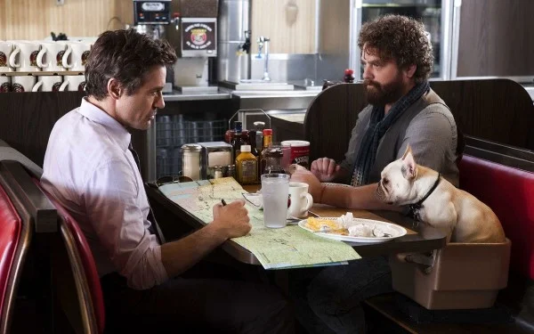

Ethan Tremblay: Where's your dad?

Peter Highman: Uh... no idea.

Ethan Tremblay: When's the last time you saw him?

Peter Highman: 1977. He had his bags packed at the door and he picked them up and put in the back of his car. And, uh, drove away. Last time I ever saw him.

Ethan Tremblay: [begins laughing hysterically]

Ethan Tremblay: That's so funny! My dad would never do that, he loved me!
