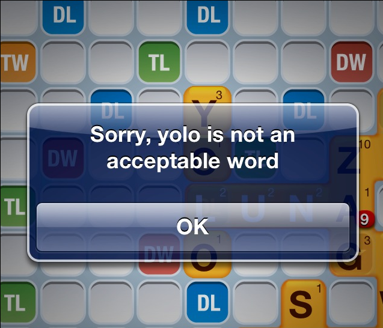

& so it has been written, said, heads have been shaken top-to-bottom, front-to-back and side-to-side about my newly found participation in the online game words with friends [apparently I’m late to the party]. I’ve been both uninspired and unmotivated by my own monotony to write lately, however real life words with friends always seem to provide inspiration and motivation for everything. Every.Thing.

**New Friends**

The newness of things; Where you from? What you do? Who yo’ people? There is always delight in the telling of ourselves and in the learning of others.

**Old Friends**

The gentle reminder of our youth. How we loved, how we learned and how we grew.

**Current Friends**

The struggles | life challenges we face may differ but we are on the same journey for spiritual, physical and emotional well-being. Security for our soul.

---

**Five Things I’ve learned Playing Words With Friends*****, In Real Life***

- Our experiences soften or hardened us to life’s ironic twist and yet *we remain* those little boys and girls eager to learn from those lessons, continuously shaping our identities.
- Everything | one is designed by God to fulfill its purpose.
- Quotes from famous people are nice & may spark a thought but true motivation that also inspires comes from those closest to you, those who love and care about you.
- There is an innate desire for 'service' in all of us, whether an advocate for health, recovery, financial literacy, empowering others or [insert your passion], there is a voice driving us towards our purpose. Listen for the voice that calls you.
- Love is an abstract emotion that is hard to quantify or define. [i.e., a motherfucker]

Made me curse, I Am
