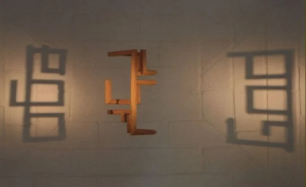

I'm approaching another birthday and my normal method of operation is to reflect on the past year; note changes, acknowledge growth and establish new expectations. I decided to jump ahead of schedule this year after reading a journal entry that was written in September of 2011. I wrote about fear. As I stand in front of it I realize that fear, as it relates to my entry was a state of anxious arousal associated with an expectation. I have faith and not too much afraid of anything [save for “I’m pregnant” and “It’s your baby”]. The fear [failure, rejection, dependency, intimacy] that I described was of an expectation that folks *that matter*would see me as a disappointment. That fear crippled me, in retrospect it *was* subconscious and found a way to speak for me and act on my behalf, although consciously I want to do well and be successful, an emotional conflict is created by a lingering expectation of being a disappointment.
Science.

**It spoke for me,**

*"Man listen, I don't want to be responsible for anyone's feelings or their emotions"*

This is probably a post in and of itself, however long story short, shorter … by design we are built to connect with someone, but at the same time I was unsure about maintaining a connection. Similar to a child pulling away from you when you attempt to help them, kiss them or show them love and they want nothing to do with you but in turn they can’t stand being more than two feet away from you.

Intimacy and dependency.

**It acted on my behalf,**

I recognize that I have subconsciously sabotaged relationships.

Listen, it's hard to beat something when you can't clearly see it. I didn’t know what was causing my superego to dawn its cape. This part of me was harsh, cruel, nitpicky and condemning.

Rejection and failure.

\_\_\_\_\_\_\_\_\_\_\_\_\_\_\_\_\_\_\_\_\_\_\_\_\_\_\_\_

A lot of what we believe about ourselves; are or aren’t capable of, can & cannot do, and what we feel we are or aren’t entitled to is shaped by our id, ego and superego [Freud].  My fear of being a disappointment was about protecting and preserving my ego.

I have a BIG ego.

Exposing, illuminating and eliminating my inner conflicts, has allowed me to realize my dreams into action and will allow me to have [and maintain] a four letter word beginning with L and ending with E.

Word.

& I four letter word beginning with L and ending in E  y’all so do as I say not as I *did* … disappointment follows unrealistic expectations. Don't lose your way.

I Am
