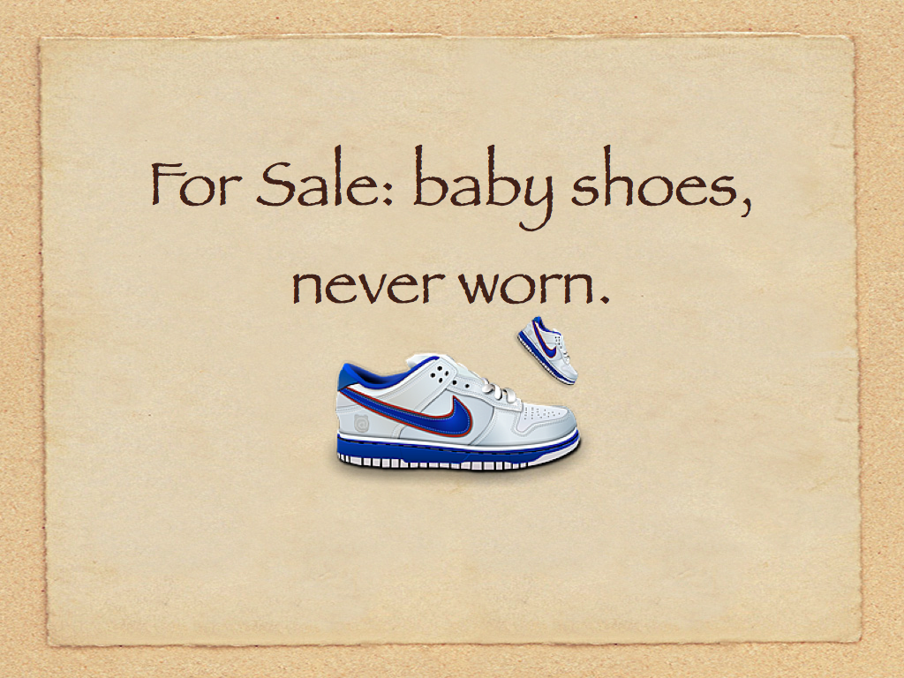

*"Blogging: Or writing in general. In my heart, there is an epic writer. But in my head there is an epic procrastinator. I think about writing every day. I want to blog..."*
*September*

Inspired by the [legend](http://www.neatorama.com/2012/11/08/A-Six-Word-Short-Story-by-Ernest-Hemingway/) of the six word story, motivated by a desire to write.

**Six Word Memoirs**

**A friend loves at all times.**

A baby, a successful career, a new car, a new home, a new love, an amazing vacation; It is the character of very few to honor without envy a friend who has flourished. A true friend, and I do not mean avatars on digital lists, chooses to rejoice with those who succeed rather than envy them. This can be difficult at times, but when the glow of success or blessings dim, the friendship remains brighter and more satisfying than ever.

**Being single or not being single.**

Among my single girlfriends [Read: friends that are girls], this is a popular meme. Serving as a willing conduit into the world of men, aside from them I usually stay away from the social discussions surrounding relationships. We were designed differently, the way we think, act, and respond are designed to be complementary not divisive. We need to change the conversation from list, rules, and then rescue love from the abyss that is romance.

Being single was never a problem for me & I’m comfortable in love, listen to me now and believe me later.

**Let others make their own choices.**

I’ve observed folks make decisions different from the point of view I’ve provided on several occasions, however cleverly packaged as an alternative [Read: the same] option. I’ve learned two things from these experiences. 1st, to stop providing a point of view. I now suggest they ask God instead of valuing the opinion of man. 2nd, they are choosing rather than deciding.

*Choose,*To select [a person, thing, course of action, etc.] from a number of alternatives.

*Decide,* To bring to an end; settle conclusively.

\_\_\_\_\_\_\_\_\_\_\_\_\_\_\_\_\_\_\_\_\_\_\_\_\_

& a few of my favorites from twitter using the #SixWordStories hashtag

**Never take good feelings for granted.**

**Not everything you attract is desirable.**

**Being aware doesn't mean you care.**

Merry Christmas & Happy New Year

I Am ...
