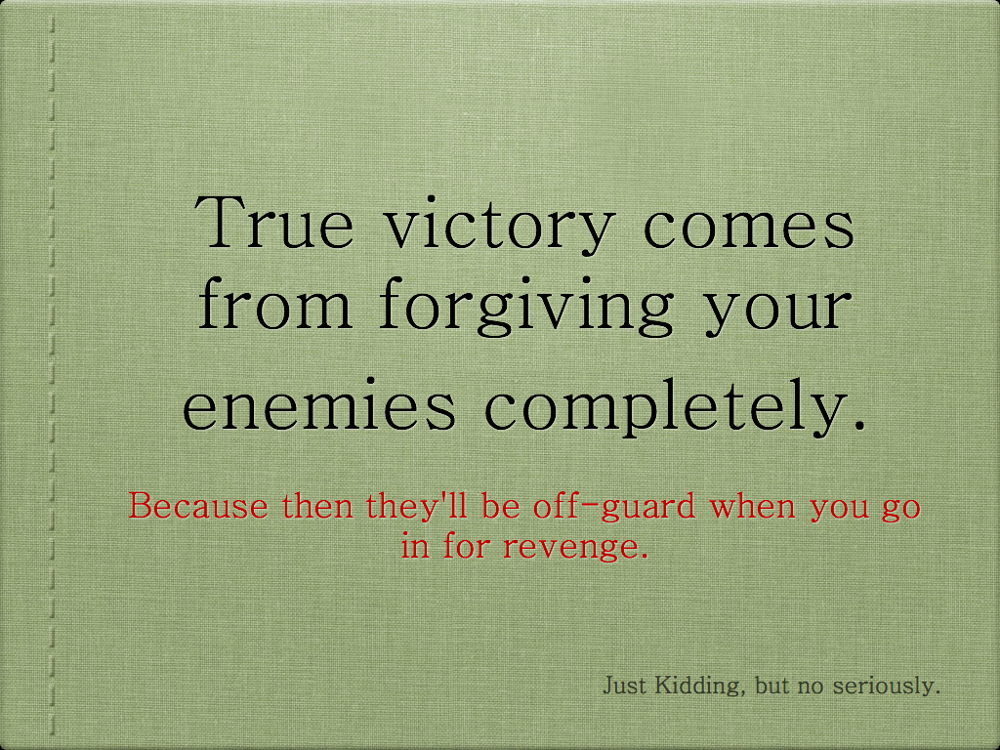

This week featured conversations with three friends, although their stories were unrelated they shared similar themes. A hunt for and the end of; relationships, friendships, and connections.

**of The Hunt**

True story. At times we desire to connect, but not to share of ourselves but to fill holes.

**of The End**

I don’t understand why people invite, create or allow chaos when ending a relationship. I had a friendship end as recently as a few months ago. I didn’t argue, I didn’t ponder, I moved on as I’m sure they have. Understand and accept that relationships sometimes end. Just walk away, don’t scream, don’t bite, don’t slash tires, don’t have their power turned off, don’t use their credit card to purchase a vacation to Africa and surely don’t use their social security number to open an account with Sprint & then use "their" new iPhone to prank call them. Also true story.

Don’t misunderstand my ramble, I love ‘unforced’ connections shared with my family, close friendships and for things that I Am passionate about. I’ll connect with a homeless person if they want to talk about technology, photography and or pizza.

Man I love pizza.

I don’t have many connections, I believe we should look at the quality not quantity, and also the meaning of our relationships, particularly the one with ourselves. Although friends can fill some holes in our lives, it is important for us to understand why the holes are there.

I Am
