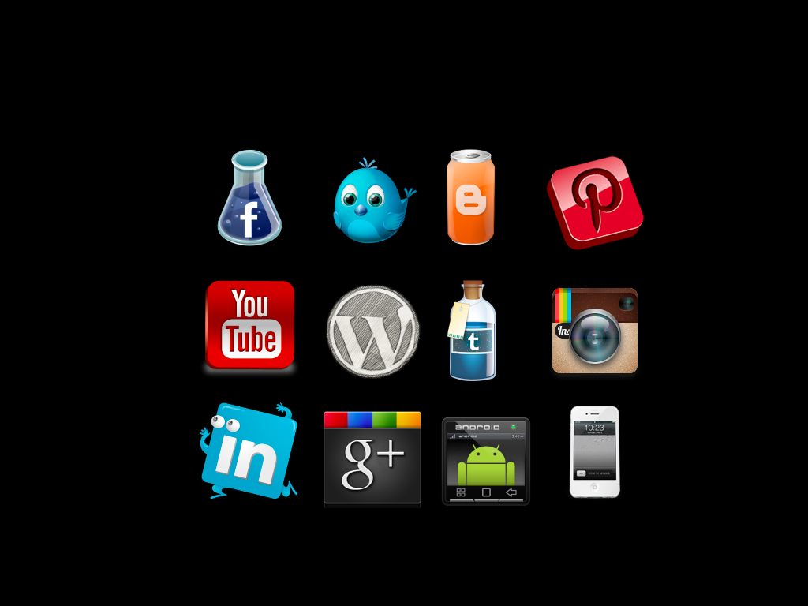

***FIve things I wish you wouldn't do with social media* ...**

I’m fond of a lot of things & while I love to discuss music, technology, food, or photography they are hard to discuss intelligently at times. I understand that there is always dissent which makes for great debate. However, if I say I prefer thighs over breast there is no need for someone to say to me that the merciless god of perfection hand selects each breast. I value your point of view but not when it comes from a place of authority.

***Please don’t devalue my choices, lets agree to disagree.***

Are you using Twitter, Facebook or your blogging platform as black people meet dot com? I see you replying to those hor'ticulture shots on Instagram full of air compliments. I have no doubt that meeting via social media can be valuable and lead to a meaningful connection. However,

***Please stop using every single social media site for a potential fling.***

I'm not sure if we attempt to heighten awareness during times of disaster or rather we engorge in disaster voyeurism. Is there anyone who is not aware of what occurred? Anybody? Sending out links of news reports, retweeting CNN, sending links of photos ... does this help any of the victims? Those actions probably make us feel better, not the folks who actually need help.

***Please stop the over-consumption of disaster news beyond the scope of whats necessary to know whats occurring.***

I like Twitter for interacting with people who have similar interests. In most ways, I prefer this to Facebook where it is lets be friends or else. Because you like a comment or link that I share [or vice versa] and we are not already connected doesn't mean that I want to be added to your friends list. Please allow me the space to share some info and laugh 140 characters at a time homie.

***Please don't equate interacting online with wanting to be added as a friend***.

Sending covert tweets & status updates aimed at folk’s soul for over sharing links, for only tweeting salutations, and for shameless, unending self-promotion. Caring how people use their social streams? They are free to use it as they wish, just as you are free not to follow, not to friend, and not to comment. Whatever you decide go about it quietly.

***Please mute your dissent on how others use social media.***

I Am
