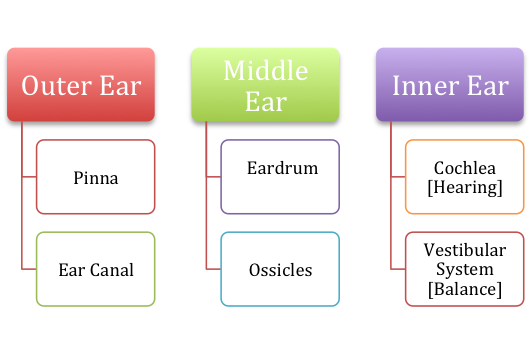
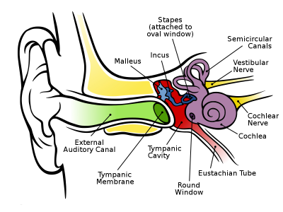

This article was written and posted on [Dr. Kari Campbell Dot Com](http://www.drkaricampbell.com/2012/05/greater-than-sum-of-its-parts.html) on May 15th 2012 before I was diagnosed with otosclerosis. I've recently completed an operation to treat the hearing loss, a stapedectomy, where my surgeon (otolaryngologist) bypassed a diseased bone in my middle ear with a prosthetic device that allows sound waves to be passed to the inner ear. I will provide a follow up article and discuss the outcome once I have recovered.
... because you care.

Outer-Middle-Inner.Ear

Huh?

Hearing loss has come to me more recently. The cause has yet to be established. Hearing test reveal 53 percent loss in my right ear and 50 percent loss in my left. The effects have become more evident in the past three months where it has become increasingly difficult and embarrassing in my most important relationships; family, friends and work. I have been unable to hear in meetings and having to ask people to repeat themselves. I’ve become exhausted with the effort of reading lips and listening. Ignoring your hearing loss won’t help. It is time to take ownership.

- Men are more likely to experience hearing loss than women.
- Approximately 17 percent (36 million) of American adults report some degree of hearing loss.
- There is a strong relationship between age and reported hearing loss: 18 percent of American adults 45-64 years old, 30 percent of adults 65-74 years old, and 47 percent of adults 75 years old or older have a hearing impairment.
- It is estimated that approximately 15 percent (26 million) of Americans between the ages of 20 and 69 have high frequency hearing loss due to exposure to loud sounds or noise at work or in leisure activities.

Source: [National Information Center on Deafness and Other Communication Disorders](http://www.nidcd.nih.gov/Pages/default.aspx)

**The Parts**

Outer Ear

The outer ear has two parts, the pinna & the ear canal. The pinna is made up of cartilage and covered by normal skin. It picks up sound vibrations and directs them into the ear canal. The ear canal is an open tube with a skin lining. There are hairs at the entrance to prevent things getting into the ear canal. Just beyond the hairs are glands that produce wax that spread to cover the skin in the ear canal and helps to keep it healthy. The ear canal normally cleans itself and clears the wax out by itself. This is worth noting because a lot of the problems that occur in the ear canal are caused by people trying to clean their ears out.

Middle Ear

The middle ear is made up the eardrum, a thin membrane that separates the outer ear from the middle ear and tiny bones called ossicles; more familiar by their shapes; hammer, anvil and stirrup. The eardrum picks up the sound vibrations traveling down the ear canal, it vibrates and makes the ossicles vibrate.

There are additional players in the middle ear. The malleus, which forms part of the eardrum. The malleus is connected to the incus. The incus is connected to the stapes. The stapes fits into a tiny oval window that opens into the inner ear. The middle ear has a lining that usually secretes a tiny amount of mucus. This mucus is drained away through the Eustachian tube. If the lining produces too much mucus this blocks up the Eustachian tube and air cannot get into the middle ear and the mucus cannot drain away properly. The middle ear space will fill up with mucus and then the eardrum and the ossicles will not be able to vibrate properly to transmit sound.

Inner Ear

The inner ear has two parts. The cochlea, which deals with sound vibrations and is responsible for hearing and the vestibular system, which is responsible for balance.

The cochlea is filled with fluid and contains a delicate membrane lined with tiny hair cells. The hair cells are all connected to the hearing nerve. Vibrations of the ossicles make the fluid vibrate. The vibrations are picked up by the hair cells. The hair cells change the sound vibrations into tiny nerve signals. These nerve signals then travel along the auditory nerve to the brain. In the brain there is a special area where these nerve signals are interpreted as the sounds we hear. Damage to the cochlea or hearing nerve causes hearing impairment or deafness.

Anatomy of the Human Ear

Credit: [Wikipedia](http://en.wikipedia.org/wiki/Ear)

**Things to Know about Hearing Loss**

- There are two main types of hearing loss: Sensorineural hearing loss (where there is damage in the inner ear - cochlea or hearing nerve) and conductive hearing loss (where the problem lies in the middle ear - ear drum or ossicles)
- Hearing loss is a major public health issue that is the third most common physical condition after arthritis and heart disease.Gradual hearing loss can affect people of all ages; varying from mild to profound. In age-related hearing loss, known as presbycusis, changes in the inner ear that happen as you get older cause a slow but steady hearing loss. The loss may be mild or severe, and it is always permanent.
- Noise-induced hearing loss may happen slowly over time or suddenly. Being exposed to everyday noises, such as listening to very loud music, being in a noisy work environment, or using a lawn mower, can lead to hearing loss over many years. More often than not severe tinnitus (or ringing in the ears) will accompany the hearing loss and may be just as debilitating as the hearing loss itself.
- Other causes of hearing loss include earwax buildup, an object in the ear, injury to the ear or head, ear infection, a ruptured eardrum, and other conditions that affect the middle or inner ear.

Source: [Hearing Loss Association of America](http://www.hearingloss.org/content/types-causes-and-treatment)

The Sum[mary]

Don’t suffer in silence, pun intended. My experience has affected me psychologically; my performance at work has suffered and I excused becoming virtually recluse as being introverted. When someone has a hearing loss, the first step in coping with it is simply acknowledging its reality. Easier said than done for most, but you can’t take the necessary steps to reduce the impact of a hearing loss if you deny it. The road begins with assessment and diagnosis.

Be greater than, happy hearing.
