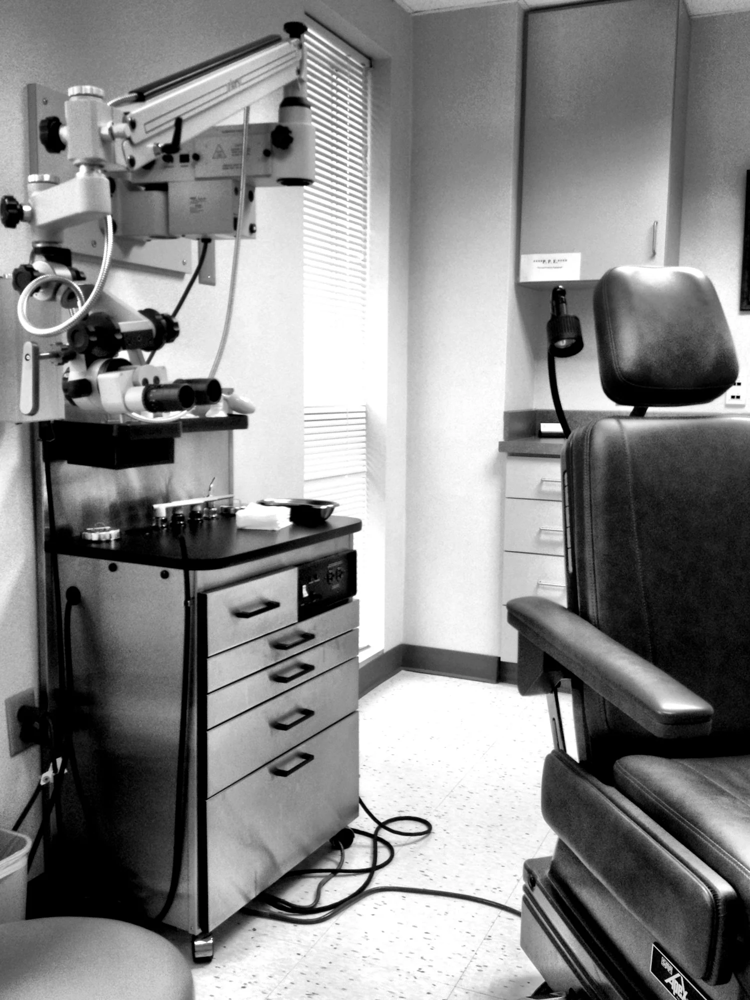
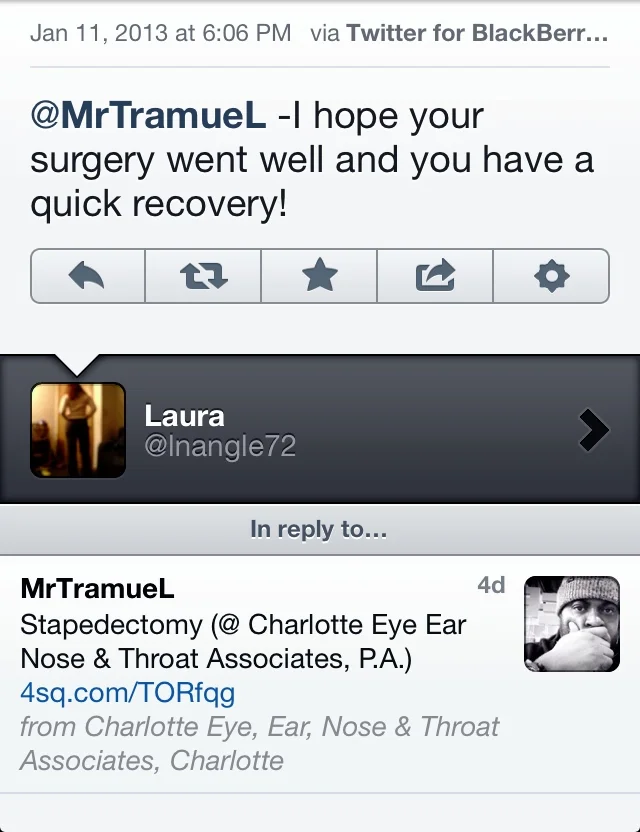
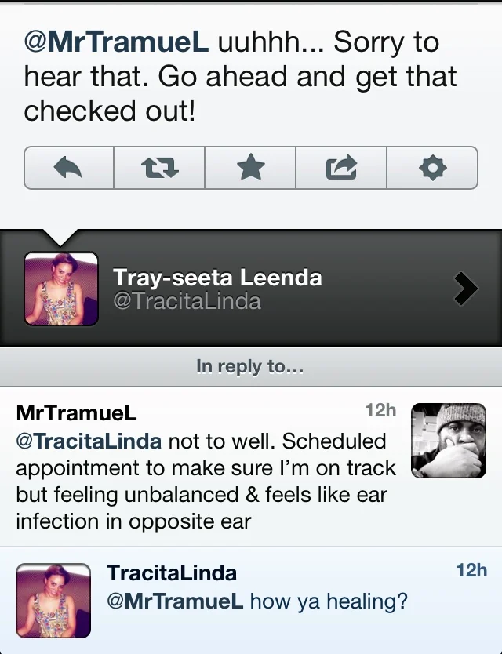
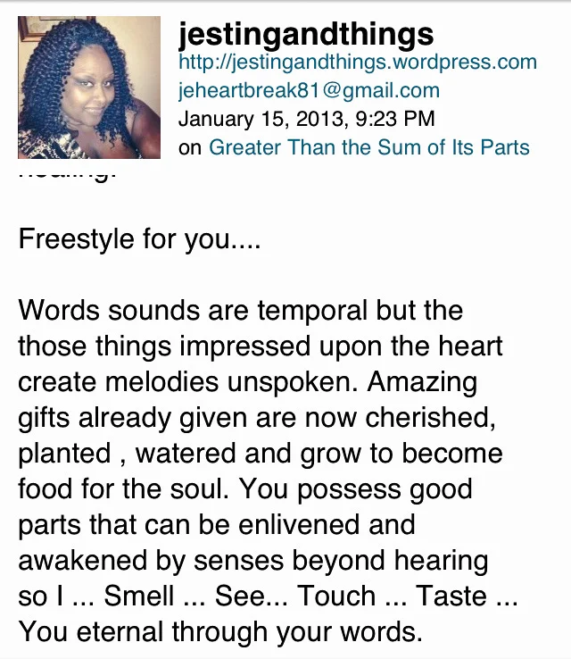

When I tweet it's never to spark conversation, most of the time it's just me talking. I do however enjoy the conversations sparked from platonic, non-flirtatious quips that evolve to observations of feelings or thoughts.

I was asked on a questionnaire by [Sunny](http://sunnydelyte21.wordpress.com/)*"What simple gesture have you recently witnessed that renewed your hope in humanity?"* at the time I responded with folks that share a common bond i.e., photography, running, youth sports, etc., these folks of all colors, socio-economical & religious backgrounds don't discriminate.

If asked a few days ago my response would be different; ***the compassion of others***.

Below are two examples of how folks responded to my ear surgery.

Laura

"Tray-seeta"

Certainly is a reminder to offer that same compassion to others.

Special shout out to [Jess](http://jestingsandthings.com/) and her freestyle prose ...

@Jessicaw1981

I Am
