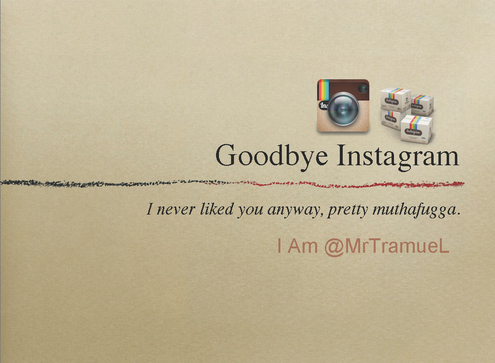

Because you care.
Inspired by an unresolution, and an attempt to organize how I spend my time. I let go of Instagram, Tumblr and Posterous. The latter being the hardest because it was my introduction to blogging and their platform makes it very easy to do. Posting quotes there, images somewhere, music another place and books another instead of using one 'ring to rule them all.

Squarespace is my 'precious.

I will use this Wordpress to post All Things TramueL, things I have a passion for:

**Photography**

Shots taken with my iPhone4s or my Panasonic Lumix.

**Books**

Used sparingly as I will only share 5 star reviews. However, I will post meaningful quotes from the books I read. I've challenged myself to 2 books per month. I commit to that, anything above is a plus.

**Music**

I will use this sparingly as well. I'm no music critic I Am a fan, that will translate better. I will share those unknown artist you may or may not be aware of.

**Writing**

Outside of my random observations about nothing and yet everything, I will continue the "He Said, She Said" posts of personal quotes & by personal I mean quotes from regular folks like you and I. I understand quoting celebrities and famous people, they share meaningful things but so do most non-celebrities. I'm still of the opinion ... "Fuck a quote, tell me what you know."

A quick note in response to an anonymous reader who believes I write to hide because my blog is not popular [in their eyes]

I don't write to hide and my blog is public; each post is sent to Twitter, Facebook, LinkedIn, 22 blog subscribers & 3 email subscribers. My blog will never be popular because of my writing style and because I don't write about things absorbed through the media.

It was never my expectation to have a huge blog. Blogging / writing started as something I like opposed to something to do, there is a very real difference. If and when the time comes I will "let go" and move on to the next.

I Am
