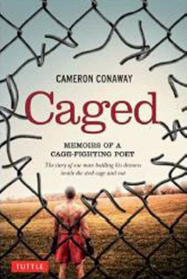

Caged\_Book Cover

Balance.

The life of a fighter, the life of a writer.

Cameron Conaway is a poet and for some time, a cage-fighting mixed-martial artist. His relationship with a demanding father provides the foundation for this inspiring memoir. Caged begins in Conaway’s childhood, where he describes an intolerant and at times verbally as well as physically abusive father. From the outset of the book, it is inevitable that his parents’ would divorce. To make matters worse, neither Conaway nor his sister enjoys being around their father during court-mandated visits. A traumatic childhood experience occurs, a clash ensues and a brothers attempt to protect his sister from their fathers’ abuse leads Conaway to disown his biological father at the age of 13. The genius of this writing is how Conaway’s admiration for his father yet hatred for the way he was treated, shines a spotlight on his own inner dynamics. A craving for his father’s approval pushes him to excel.

The book’s structure is very interesting, while it chronicles Conaway’s childhood; and we eventually catch up with present day, the chapters function as a journal of essays that detail the noxious weeds of an unhappy childhood and their implications on his adult life. The essays are an invitation to join the author on a journey of self-discovery as he provides moments and ideas that shape him into the fighter, the writer.

As with the articles on [The Good Men Project,](http://goodmenproject.com/) where Cameron is a contributor and social justice editor, Caged raises questions of masculinity and ideas of what it means to be a man.  A power' full point comes at the end of ‘Crime and Astonishment’, Conway writes an open letter to his father, ‘I don’t want to see you and I don’t want a relationship with you right now’, followed by a power' filled statement, ‘You’ve provided me with everything I’ll ever need to be curious, grateful, humble, and successful in this world. For that, I love you.’

Balance.
