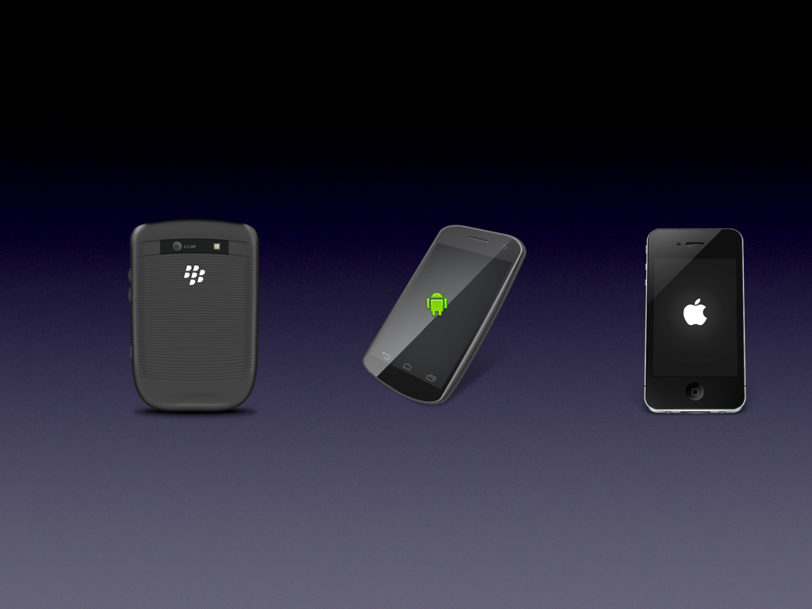

Not so random observation about opinions.

**Pre'Ramble**

Last week I tweeted "Y'all still use Blackberry or nah?" in response to an advertisement for Blackberry Ten. Truly, I wasn't throwing shade ... I'm too Summer. A non follower and I exchanged a few pleasantries after which I explained I wasn't trying to clown her Blackberry usage. It reminded me of a tweetversation two years ago with a friend on Twitter, this is someone whom I know personally not just an avatar from a digital list. We were both Blackberry users on Verizon and eligible for an upgrade. We were also clear that we were switching platforms, however undecided on which. Windows lost immediately, leaving Android and iOS. We exchanged the normal concerns for each; security, fragmenting, closed, customization, upgrade, etc., ad nauseum.

Mute your dissent.

& then our twetversation was ambushed. Someone tweavesdropping decided they would ~~force~~ provide their opinion. I don’t mind you sharing your point of view but when it is presented from a position of assumed authority, my *opinion* of you becomes that of what they say an opinion is like. [Read: Asshole] They were like "ride or die bitches" and I was like "I refuse to have conversations with you unless you are a developer at RIM, or a professor of thermonuclear astrophysics."

Science.

**Articles**

Is it me or is "In my opinion” so matter of fact, so final as if your mind can never be changed? A point of view can be changed, at the time of this writing my arguments for / against Android and iOS have changed.

**Amendments**

Highly personalized technology choices are simply lifestyles choices. You're not dope or vapid because you use Android or Apple, and you're not about that slow life because you use Blackberry.

Blackberry, Android & Apple users need a practical modus vivendi.

Shout out to my Latin teacher Shirlae Wingae

I Am
