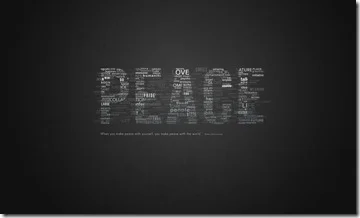

peace-wallpaper-1920x1200

> *Forget not that the earth delights to feel your bare feet, and the winds long to play with your hair. ~Kahlil Gibran*

I’m in love with silence. There are times when the sounds I love; music, my kids laughter, *her* voice … are too much for my ears. I Am not unhappy at those times however, with my will directed inwards I seek paths that allow me to get away from everyday “noise” at least some of the time. When I speak of noise I mean chaos, disorder and at times actual auditory noise. This is especially heightened now that my [hearing has improved](https://www.tramuel.com/iam/2013/01/16/compassion-of-others/).

Honoring my need for silence provides peace.

**Noise at Work**

Navigating through office politics, meetings about the meeting, he said - she said, and folks stepping on others attempting to put them down in order to bring themselves up. If you want to hold on to your lunch and your sanity, find silence and get you some peace.

**Noise in Social Media**

Opinions, links, humor, tweetversations; that's the good stuff. The noise becomes the hateful Facebook updates and tweets that some users constantly promote. I know most would say and in fact have said "Man go somewhere and be quiet or delete those folks." Perhaps, not everyone or thing that creates noise is bad and I've learned that not every place I go or have to be is free from noise.

> A perfect Sunday, I don’t dread Monday at all.
>
> — I Am(@MrTramueL) [January 7, 2013](https://twitter.com/MrTramueL/status/288089038538280960)

I remember running that day; earphones in, music off, wind on my face and the only thing I could hear was the Earth in its natural state.

Peace.
