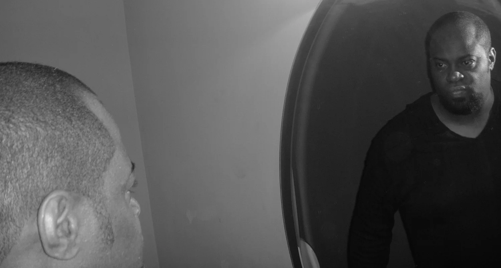

The Man In the Mirror

When I look at myself in the mirror the reflection staring back at me is one of my 18 year old self; young, thin, full head of hair, with eyes bright enough to catch a glimpse of my future; I eagerly anticipate the next chapters of my life. The start of this year has presented me with the realization that time waits for no Wo/Man.

Reminders that the years have passed.

**Graduations.**

ANT [son] is graduatiing from high school this summer and DFT [daughter] from college.

**Reunions.**

My own 25 year high school reunion. Class of '88

**Death.**

From time to eternity. Family [Imediate and extended] have experienced loss this year.

**Love.**

A choice was made.

Time is a valuable asset. You can educate your children, reunite with others, celebrate the lives of those that pass, you can even find a new person to love ... only time is not renewable.

I Am
