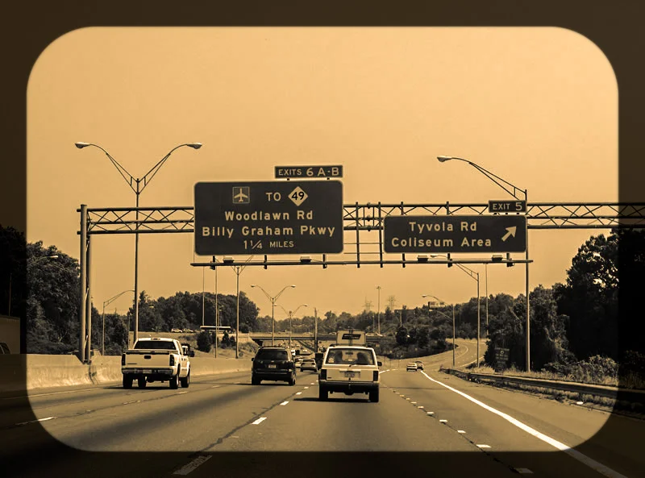

Memories
There is a very small mark on the outside of my nose, noticed as a slight discoloration. On a scheduled weekend visit with ANT many years ago I reminded The TramueL Formerly Known As that I had never had chicken pox and argued against being around him as he was in full effect. She quickly pointed out the above mentioned mark as evidence of having had chicken pox as a child. I corrected her and explained that the mark was the result of riding down a very steep hill on the side of my face.

I will not bore you with the details of our discussion however for someone I believed to have known me very well I thought it was odd that she couldn’t remember such a specific detail. Two very specific things I know that I’ve shared with her; as a child I have only had mumps and the story of sliding down the hill on my face after removing the training wheels from my bike.

That story is significant only in combination with another as they were both sparked while returning from an appointment the other morning. I won’t attempt to explain the inner connectedness of my brain to those specific events on that specific day. I will liken it to Déjà Vu. Leaving that appointment I passed through my old neighbor ‘hood and as I approached the apartment community where I previously occupied space I was met with memories. As I merged onto the highway; of this particular stretch I traveled to work every day *77 miles per hour on Interstate 77*. My scheduled in-time allowed me to miss the morning rush, the traffic patterns were similar on this day as they were on that day and my thoughts came crashing together in the way my Infiniti, his Ford and her Honda did; a love story starring metal, plastic and glass.

Later that evening while reading [The Autobiography of an Ex-Colored Man](http://en.wikipedia.org/wiki/The_Autobiography_of_an_Ex-Colored_Man), I highlighted the following passage …

> *In the life of everyone there is a limited number of unhappy experiences which are not written upon the memory , but stamped there with a die; and in long years after, they can be called up in detail, and every emotion that was stirred by them can be lived through anew; these are the tragedies of life. We may grow to include some of them among the trivial incidents of childhood – a broken toy, a promise made to us which was not kept, a harsh, heart-piercing word – but these, too, as well as bitter experiences and disappointments of mature years, are the tragedies of life.*

If I could have pressed a “like” button I would have, really hard, and multiple times. I smiled at the significance of my history and at this verse of his story. The senses; the sound of rain, the smell of fresh linen, the taste of strawberry ice cream, the sight of a familiar place or an embrace can evoke many emotions. Whether happy or sad most of us opt to remember the great times all the while not impressed with the bad times; there are however those moments you cannot escape.

The die is very strong.

I Am
