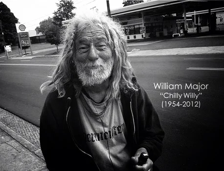

William Major

If I thought you would listen.

###### Photo Credit: Facebook

**Photography**

Every morning on my drive and subsequent walk to work I pass four of Charlotte’s homeless, they never ask for anything, most make eye contact and provide the proverbial head nod acknowledging the repetitive dance of time. Every morning at nearly the same spot we pass. Every morning I look down at my camera with the thought that today is the day I will ask them for something; a photograph, their name and their story. Yet, every morning the nerve escapes me.

**Books**

I’ve found a formula to read more and will triple my reading goal for this year. Although I want to share my thoughts on everything I read I've realized that I am not interested in making something I find enjoyable an assignment. Reading is FUNdamental and is something to do with joy or it becomes a task like cutting grass. I don’t want to cut the grass. I’ve read and reviewed a few books here on the blog, some books I just read. There are some unfinished reads in my Kindle, in my car, on a table, on my dresser …

**Buzz Words and Phrases**

"Shoot me an email", "Bubble it up", "Piggy back off of ..." at times I dis-like hearing these idioms. We use them on a daily basis at work, home and in these social streets. Because you care,

Piggy Back: From my reading it has nothing to do with pigs and possibly transformed over time via folk etymology from the early forms of; “pick pack,” “pick back” and “pick-a-pack," see no mention of pigs, we can assume the bacon came later. Pick is old English dialect related to pitch, meaning to throw or place [like pitch a tent]. Pack was most likely whatever was being carried, inert or human, so pick-a-pack may mean to pick [put] the load on it's back. The use of back in some early forms supports this interpretation. Perhaps we got lazy, for example we say "I want some grape nowlaters" instead of "I want some grape Now and Laters." The science is true, don't be misled by facts.

**Music**

We all know music feeds the soul, for most of us it provides a soundtrack to our lives. Lately I feel like Harold Crick, but instead of an author narrating my life it is 80’s & 90’s Hip Hop. Every conversation, every thought, every step I take, every breath a make ... a tune pops into my head. For example, I am a part of the “good morning email crew” we politic on the daily about nothing and yet everything. Myself and another play the mobile version of Words With Friends, this was unknown to the other members but somehow it worked its way into the discussion. They threw much shade  [didn't bother me cause I'm so summer] and without a salutation or well wish, I started singing the lyrics to "Games people play" By Sweet G (1982). It's driving me crazy, but I don't want it to stop.

I Am
