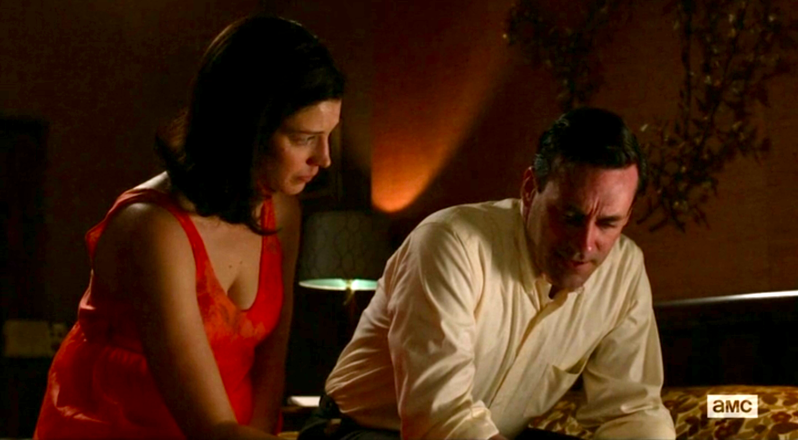

#AMC Mad Men The Flood

**Megan:** “I felt better but now I don’t.”

**Don**: “Why?”

**Megan:** “Because who knows what you’re feeling. I don’t know what to say to her except I’d tell you to ask your father but he’s at the movies. I should’ve said ‘He’s just drunk.’”

**Don:** “You’re better with them. You don’t understand.”

**Megan:**“I do. You don’t have Marx. You’ve got a bottle. Is this really what you want to be about when they need you?”

**Don:** “No. I don’t think I ever wanted to be the man who loves children. But from the moment they’re born, that baby comes out and you act proud and excited, hand out cigars. But you don’t feel anything. Especially if you had a difficult childhood. You want to love them but you don’t. And the fact that you’re faking that feeling makes you wonder if your own father had the same problem. Then one day they get older, and you see them do something and you feel that feeling that you were pretending to have, and it feels like your heart is going to explode.

Powerful scene.
