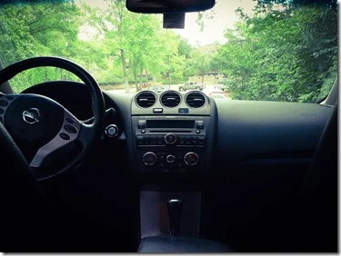

Photo May 04, 1 53 14 PM

Running on empty. It is late night and I am restless. Many of the weeks activities playing back in my mind, thinking about the things I accomplished but also the things I did not. I believed staying up until 2:30 in the AM and waking up at 6:30 was what I needed to maintain my life; taking care of the things I needed for myself early so that I had time to take care of the needs of others.

Questions surface during the quiet time, while others are sleeping. Questions concerning work; an inescapable reality, it is how we pay the internet bill to write blog post. I've realized through unbidden answers to those questions that my crisis is less about time management and more about deeply rooted ideas about myself, God and life.

How do we become aware of the path we are called to that our lives are transformed as a result?

I'm going to stop questioning every move from the back seat and use my energy, intellect, skill and care to reach that destination.

I Am
