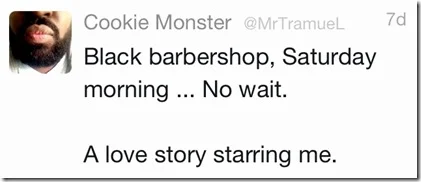

Photo May 18, 3 22 22 PM

That was last week, fast forward to this morning and my failed attempt to get Brian’s hair cut. A phone call to Malcolm, unavailable. We drive to two other shops, full. The rush due to game time [youth baseball] at 11 in the AM with a birthday party directly after, constant reminders from his mother that “Brian needs a haircut” and delivered to him “You need a hair cut bad.”

***Steps up to the plate …***

Brian’s hair while high isn’t the mess that all of this trouble is worth. I’ve never understood until today why hearing “… you need a haircut bad ” vexes me so much. First with Aaron & now Brian.

***I’m going to swing for the fence …***

The actions and comments of women, while delivered with good intentions to help us become better men, at times weaken our sense of self.

***Home run.***

Literally and figuratively the boys just brush it off.

Weakening our sense of self can lead to self-doubt, separation from self, and the consequence of our incomplete evolvement. Our inner critic goes to work and one of the most common causes of self-defeat is the expectation that others [especially our parents] will see us as a disappointment. When we transcend this conflict through inner knowledge [for example the way we teach our daughters that their hair does not define them, to be comfortable in their own skin, and that black is be you (tiful)], we discover our true self; which is the realization of our goodness and our value.

Lil' Mr

I Am.
