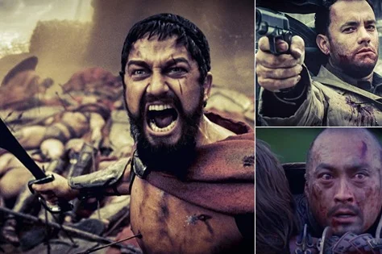

View album

This weekend while conscious [that annoying time between naps] & flipping through the channels I happened upon three war movies; three time periods, three geographic locations, three campaigns. There is a common theme. What, asks the films, is the worth of a single human soul?

Sometimes a loss can be a win ...

**300**

Loss: King Leonidas. Leonidas had been warned by the oracle that either Sparta would be destroyed or their king would lose his life. Leonidas chose the second alternative.

Win: The death of a king forced all of Greece [Spartans, Tegeans, and Athenians] to defend itself against the Persian army.

**The Last Samurai**

Loss: Katsumoto, samurai leader who aspired to the ideals of; discipline, loyalty, and benevolence leads a rebellion rooted in the inability of the samurai to envision duty and honor without status, or to be a part of a nation striving for growth.

Win: Japan moves forward with industrialization, undergoes radical social and political changes to become the technological marvel and world competitor that we know today. Bonus, Captain Algren regains his honor.

**Saving Private Ryan**

Loss: Captain John Miller [& all but two of his squad]. Miller heads up a squad of men with the primary task of finding Private Ryan, whose three brothers have all been killed at various locations all over the world as American soldiers.

Win: An important bridge is saved and the battle is won, a son survives and makes it home, lest his family be deprived of all its male offspring.

There are many historical inaccuracies as we are dealing with reality; the Battle of Thermopylae, Satsuma rebellion, and the Invasion of Normandy but sometimes, legend, lore and fantasy merely embellish the past. Fantasy always tops reality.

Sometimes a loss can be a win.

I Am.
