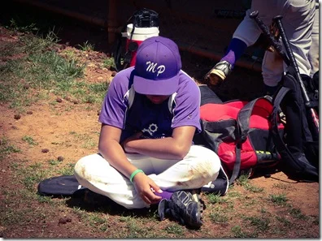
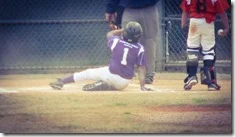

P1260706 Edited

I grew up across the street from a full service park that featured a recreation center. My exposure to sports and competition starts there. While most of my friends participated in sand lot football and basketball my play, from a team perspective, did not begin until junior high where I played football and ran track. I was a pretty good basketball player too as I made the junior-varsity team in high-school. I wasn't a superstar but I excelled at anything I attempted. In some ways I was uncomfortable in the limelight, content living in the background, as long as I felt useful and appreciated.

As parents we attempt to relive some of those lost childhood memories via our own kids.

**A few things youth baseball has taught me ...**

*To have fun ...*

Striking out, dropping the catch; society in general is negative and teaches us that losing is bad. Your body gets valuable information on how to do it better each time you swing the bat or drop a catch. The kid that shrugs it off and dust himself off is going to have higher success. I've learned to help develop the feel for competing, for trying hard, and most importantly for having fun. If sports become work, they’re no longer fun.

*That I Am a fan ...*

LMT was the participant, not me. I made sure my expectations were based on his needs, not me reliving through him. I remember a comment he made early in the season after a game at a time I forgot that I was only a 'fan' ..."Dad, I bet you didn't hit every ball." He was right, I didn't. I remember being nervous and even backed off at times. From that point I just watched and became the biggest fan, allowing him to need me on his terms.

*The process is greater than the outcome ...*

It had been a few years since LMT last picked up a ball, bat or glove. My thought process was to keep him active for fitness, however children play sports for fun, friends and participation. I wanted to be honest about his athletic capability, competitive attitude, sportsmanship, and skill level and thought he was more suited for basketball or track. I watched him develop over the season and by de-emphasizing winning and encouraging learning the skills, playing the game and having fun everything improved. By focusing on hitting, running, sliding, and catching; you avoid defining success and failure in terms of winning and losing.

At this stage in the game it is about acquiring and mastering the skills needed for the next level.

Were winning counts.

P1260696 Edited

I Am
