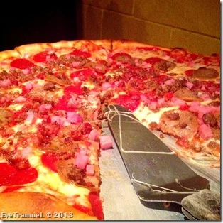

photo

**Tip 1***20%*

Time: 10:25 PM EST

Date: May 25th

Day: Friday

Restaurant: Manhattan’s New York Pizza | Elizabeth Ave, Charlotte

We arrived late in the evening, only after asking what time they closed did we realize we had 30 minutes to eat, drink and by merry. We were greeted with enthusiasm and energy as if the place just opened. After being seated the server did not rush, took his time explaining the specials for the night, however he did inform us that the kitchen would be closing soon, still we sampled beer and took our time before ordering. The food came out perfect; the serviced remained consistent throughout the night.

**Tip 2***0%*

Time: 3:55 PM EST

Date: June 4th

Day: Tuesday

Restaurant: The Pub at Gateway | W. Trade St., Charlotte

We arrived late in the afternoon, only after asking if the lunch special would still apply did we realize we were inconveniencing our server. Someone took our drink order, bought them to us and waved as she bounced out the door. Another took our food order telepathically. I’m not telepathic so I assume her making eye contact with me as she stood with her pen & pad was my queue to order. The food came out perfect, delivered without a well wish or salutation; service was nonexistent except for the “Hey you! May I have some mustard?” politely shouted across the bar by my co-worker.

First I have never ‘not’ left a tip for as far back as I can remember. Hell my second job was as a server at 309 1st Street in downtown Roanoke, VA [BIG Lick standup] so I understand providing a service as well as serving.  For okay service I leave 15% and save the 20% for exceptional service. For poor service, well that was debatable until now. I’ve decided that I am no longer going to reward bad service, mostly I do it/did it because I didn’t want the server to think I was cheap and also to crush that ongoing stereotype that “we” don’t tip & by “we” I mean those of us kissed by the sun. What I want is for them to know they were bad, not bad meaning good but bad meaning horrible. Going forward I may leave a small tip, provided the poor service was because of the server, not something beyond their control and I’ll also include a note explaining why …

Mr. *I love eating The P* TramueL

I Am
