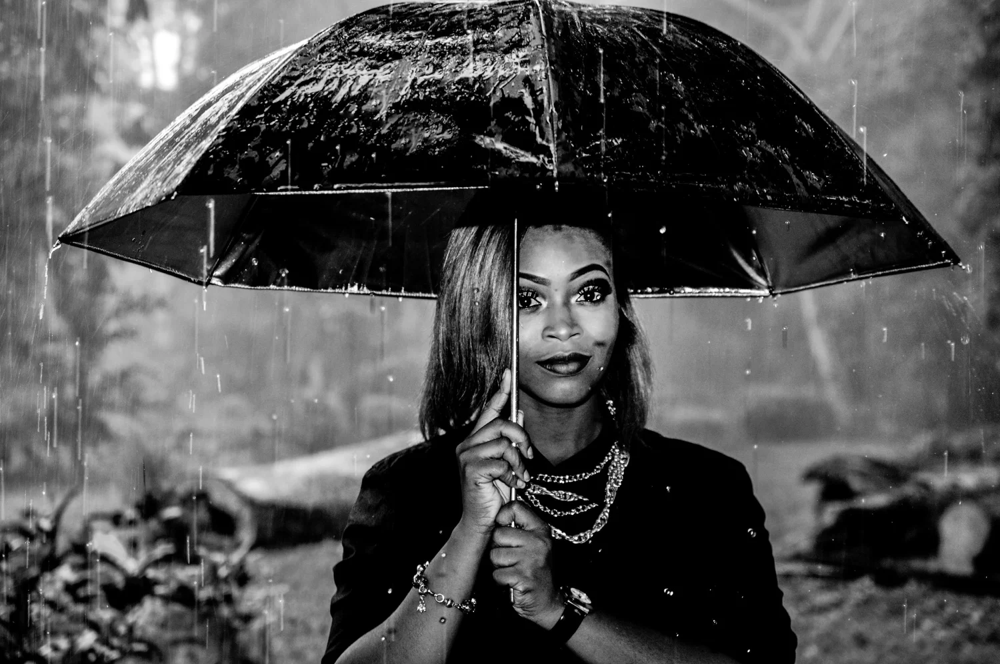

# Serendipitous Occurrences

*Rain.* This shall be known as the summer of thunderstorms. This morning on my drive to work I watched a young man offer a young woman his umbrella in passing, I don’t know what words were exchanged but it must have been fly, as I glanced back through the rearview mirror; both moved in the direction originally traveled by the young woman, both smiling uncontrollably, both moving through the rain with enthusiasm and a positive outlook. *Music.* My life is powered by a soundtrack of 90’s Hip-Hop, instinctively E-40’s Captain Save A Hoe started playing as I watched those two fade into the heavy rainfall. The lyrics go hard but there is something in our nature as men that require us to rescue, protect or otherwise save our women.

*Observation.* Women don’t want to be saved as much as served. Asking genuine questions i.e., what could I do to help you? What could I do to make your life easier? How could I be a better man, boyfriend, baby daddy, husband, or lover to you?   The Future has no interest in me washing her feet, and y’all know I love the toesies, but she expresses other ideas. Allowing women to teach us “how”, in turn we serve them and slowly but surely, I’ll put this on everything … it is reciprocated.

I Am
