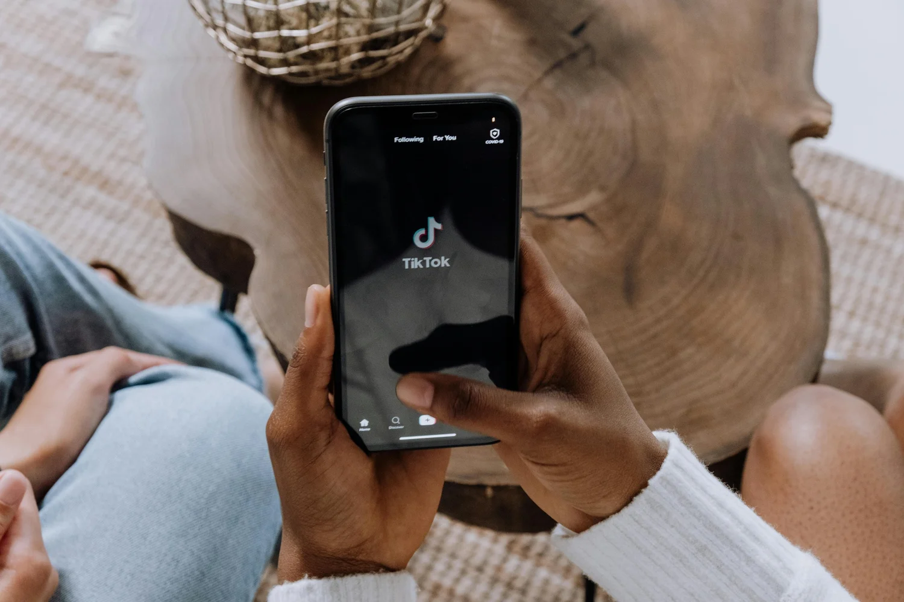

## **Connection Crabbing**

Connection crabbing is often the result of a relationship catalyst— one of two parties seeking to end a relationship, whether social media or ones that spill over into the streets. The other party's hurt and confusion become destructive and are exhibited in this manner, either out of feelings of rejection or a desire to control and hurt.

As I casually scroll through the ‘gram, someone that I follow (x) & know personally outside of Jasmine Felicia Crockett’s innanet is connected with someone else that I know (z) a good friend reduced to just someone I know. (x) does not follow (z) because they don’t know each other in real life.

***Lol, I’m just serious.***

This is tricky as the person seeking to engage in connection crabbing is not always contacting strangers that are close to the person they seek to get at, but in fact, might come to need a product and or service offered from the persons that they are contacting. However, if the motivation for contact is not pure, whether the connection crabber knows the third parties they contact or not is irrelevant. Their intention is still the same.

As I get older, I find that the people in my inner circle share more similarities in terms of values, ideas, and experiences. Although family members may differ as we've grown up together and seek to define our own identities, we are still very close. So, someone taking an interest in the people in my life doesn't necessarily mean they are trying to create connections for their benefit.

Why tho'? It's not because they can't live without me or anyone else they target. I believe some people struggle with rejection. With the prevalence of social media, they have easy access to the most important people in someone's life. It's unlikely that connection crabbing would be as effective without social media, even if the relationships affected by this behavior extend beyond social media. We aren't pulling up on people in real life attempting to force a relationship. Social media isn't to blame for negative behavior; it's just a facilitator. We are who we are, but social media enables both negative and positive behavior in ways that were previously unheard of.

I Remain,

B
