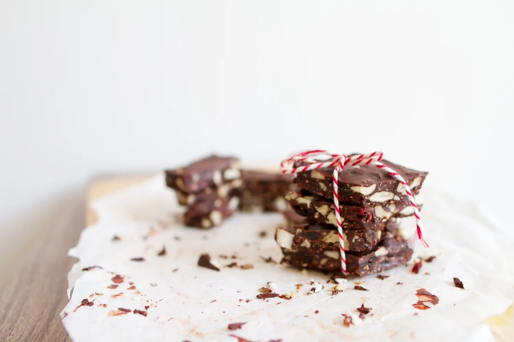

*by Cynthia Ratchford*

### Actually, there are way more than 5 ways but these are my top 5

## Five

### They both show up when you least expect it.

I have a young child at home so I try to be really careful about what we watch on television. Youtube has been my prefered source for watching videos because I can have better control over what he sees. Or so I thought. One evening, I entered asearch for one of our favorites,“Teddy Bear, Teddy Bear.” Several really cute and appropriate versions popped up. As my son and I were scrolling for THE ONE, there, mixed in for no apparent reason, were videos of women holding teddy bears, dressed in teddies, or AS teddies, and clearly not what a child should see.

*Yes, I submitted a complaint to Youtube.*

Sugar does the same thing. Someone trying to avoid sugar might not think about things like, salad dressings or condiments. Have you ever looked at a Heinz Ketchup label?

Ingredient #3 is “high fructose corn syrup."

Ingredient #4 is “corn syrup."

So... sugar and more sugar.

## Four

### There's no limit to how far they both can go.

That is, until someone gets hurt. Or dies. Even something as amazing as sex can get a little boring if you don't spice it up once in a while. But there are many, many, many stories of people taking it way too far and ending up in the hospital or the cemetary. Take a look at the candy aisle thenext time  you are out shopping. There are more choices than any one should ever have to make. Each year gets worse. The Cadbury Creme Egg, which was perfection (before they changed the formula last year but that's a different story) was taken to another level this year when they took the yellow and white “creme”, shoved it into a cookie, and then covered it with chocolate. And wait. There's six of them in a package. That's enough to cause some damage. Sooner or later, someone will get the bright idea to deep fry it in funnel cake batter at the State Fair and yes.... EMS will probably be called.

## Three

### We need to educate kids about both "S” words.

Kids get cranky and whine for the colorfully packaged “treats” they see at the cash register. They recognize it from commercials. Even before they have tasted it, they have this sense, this desire for what ever it  is. They can say the word  “chocolate” or “candy” but they don't KNOW,  really. They Just see other kids eating it and they think they should too. You struggle. Do you give in, just this once then go back to pushing fruit? But you know, once they taste it....Talking to our kids about sugar after they have become over weight or suffered other consequences is like talking to our teenaged daughters about sex when they are 3 months pregnant. It's too late. And you might say the comparison is a bit rediculous because a baby is a life changing experience. Yes. So is juvenile diabetes.

## Two

### People think the alternative is a better choice.

So let's say you decide sex with people is too risky, what with all the sexually transmitted diseases andthe stalking  and all that (it happens). So you turn to porn. Harmless enough. Until it's not. Porn has the capability to become addictive and instead of being a useful tool (there's a joke in there somewhere) in your “down time”, it replaces any human sexual contact you might have had. Porn, at it's worst has many consequences (also another story) and can be very unhealthy. So, you're avoiding sugar, but replacing it with the alternatives. Things that kinda taste like sugar but without all the harmful side effects right? Riiiight. Let's think about this. It takes chemicals to make these "alternatives." Our bodies are not made to process chemicals. So while you are only thinking about how little calories you are consuming and how your blood sugar isn't being affected, you arenot considering that THESE ARE CHEMICALS. Since our bodies are not made to process chemicals, they do strange things with them like, shove them into fat cells or turn them into diseases or cancers.

## One

### The Dark Side: The possible assaults.

Sexual assault. Rape. It is a terrible, disgusting thing that someone might do to another person. It is not something to make fun of or take lightly. The victim of a sexual assault can suffer many after effects that can last for weeks, oreven years. These effects are physical, mental, and emotional. However, with time, and the right help, a victim can become asurvivor. How am I going to work “sugar” into this? I have been wanting to give up Sugar. INEED to. But it has been hard. What finally helped me decide to give it up was thinking about how sugar is assaulting me. It is wrecking my health, affecting my blood sugar, my weight, my joints, my sleep, my moods. My physical, mental, and emotional. For me, my mindset has to be this extreme. The difference is, no one chooses to be sexually assaulted. But we choose  whether or not we put sugar into our bodies. I've made the choice to be “assaulted” and victimized” by sugarlong enough. I'm choosing to be a survivor.

*A few years back I killed Cynthia in Mafia Wars on Facebook, we've been tight ever since. She is a new wife & first time mom. That nurturing instinct is a powerful source of help in the lives of others.*

I Am
