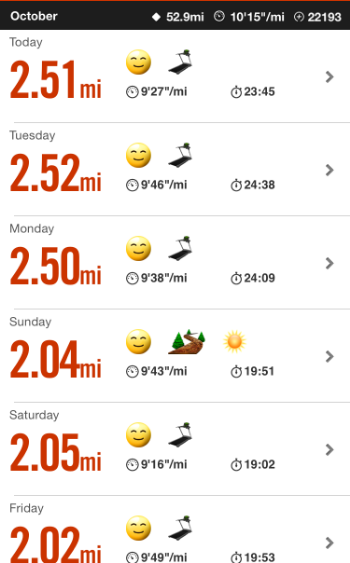
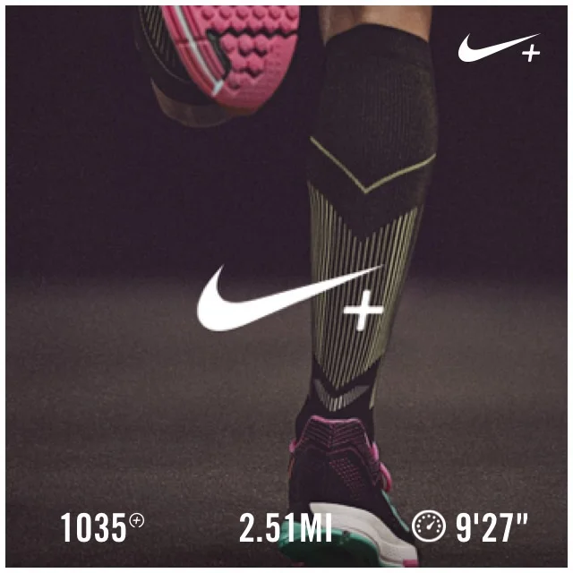

I've ran at least 2 miles everyday for the past three weeks, without injury, or fatigue. I hear my mother's voice (speaking of attending church)  "...you get up and go to work everyday, apply the same thought..." We can apply this to anything.

## No Flex Zone

(4:52) Hitting run on my Nike Running App, wondering why they haven't optimized for iPhone 6 or integrated with HealthKit.

(4:55) Dude jumps on the elliptical machine in front of me, he has on a matching short set. It 'ain't' got to be pretty, #JustDoIt

(5:01) Something in the milk ain't clean. Nike running says "1 mile completed" treadmill reads .90 miles

(5:05) 🎶 "Nobody really likes us except for us" #PowerSong Drake, 6 God (stride opens, arms swing harder...)

(5:10) Milk still dirty, Nike running says "2 miles completed" treadmill reads 1.81 miles.

(5:12) Too early for this, I woke to The Future's exposed thy. I could have stayed home and worked out. Love and other indoor sports.

(5:13) TramueL Theory of Chaos. Twenty-Five to Thirty treadmills in a row, at 4:52 only one other  was occupied. Without fail, someone comes in, cases the joint, ignores the twenty empty machines and decides they want to use the machine next to me. If this happened once? Cool. No, almost every time.

(5:16) End run. I have my headphones in but I can hear the human tornado and their public chaos. 2.51 miles completed.

I Am
