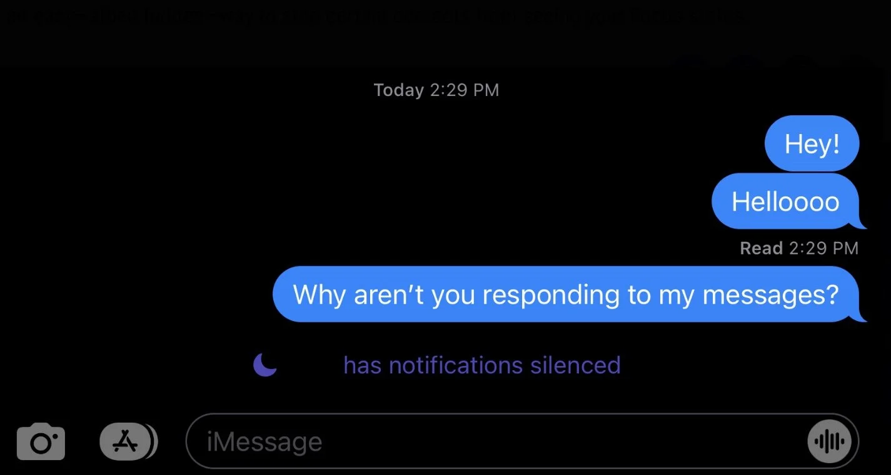

Why does this trigger people?

I silence mine because I don’t want to witness the end of time, shutting myself off to the uncertainty of whatever is going on /end

It’s not that deep. Focus mode automatically silences notifications; driving, personal, work, and etcetera.

**A short story starring ME**

It’s always very personal, “Why did you silence ME?” … assuming “ME” isn’t in danger and I don’t need to take action to protect them, rather than trying to convince ME that they are being irritating the best way out is to shift.

**Shift the focus from them to me because Virgo.**

I have a difficult time with people who ignore specific things I’ve said, or specific attributes about me. & by people I mean those who desire to interact with me on a personal level but have no idea as to who I am, or are ignoring who I am accidentally and haphazardly, or on purpose.

For example, I like bussing’ my gun #PewPewPew If someone wants to hang out with me and they’ve shared with me a number of times (for me, you’d only have to tell me once) that they don’t fuck with guns, I am not going to excitedly invite them to the gun range. Their dislike or their negative past experiences with guns remain in my memory and not because I have a great memory but because I simply stopped to listen to and care about their concerns, make a mental note and remember it for future reference. Apparently, not everyone can do this, or not everyone cares to.

If I tell you I go to (sleep, work, gym, grocery store, your granny’s house) at a specific time all the time, as in my routine. Why are you vexing me, I mean texting me at these specific times? Then they shift “something could have changed” or “I forgot” when they know nothing has changed and they could not have forgotten if they had listened with their ears and not their mouf.

The only thing that matters to them is their requests and their desire for me to be involved to produce an end result that they desire, usually one with them getting attention…

Silence is a great tool.
