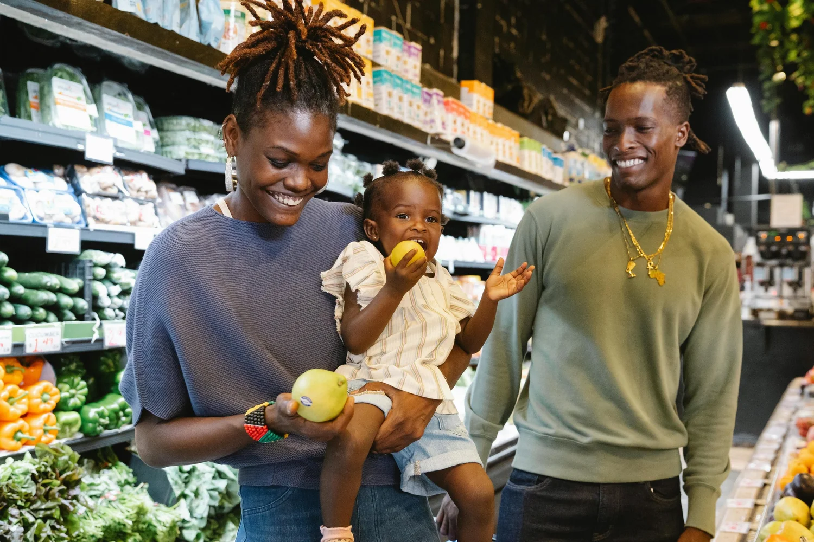

A random observation about nothing and yet, everything—grocery shopping when you’re finally buying for pleasure instead of survival.

What changes when you’re not scraping by?

It hits me in produce, this small but steady feeling that I’m no longer in survival mode. No more calculating how long I can stretch a box of oatmeal or if I can afford the fruit this week. Now, I hover between choices not because of price tags, but because I’m asking my body what it actually wants. Raspberries or blackberries? The splurge is no longer a gamble, it’s a gift I can give myself without guilt. This isn’t about indulgence. It’s about ease. About quiet. The kind of silence that settles in your bones when you’ve paid your bills, filled your tank, and walked into the grocery store knowing you can shop for pleasure, for health, for you and not just for survival.

These days, my cart reflects a different kind of math. Not just dollar signs, but macros. Protein, fiber, healthy fats. I’m not counting carbs like I used to count coins, but I am measuring. Not obsessively… intuitively. I’ve learned that fueling my body is a conversation between science and self-trust. And I don’t talk about it often, not out loud. The weight is shifting, yes, but the deeper change is in how I move and feed myself, how I show up in my own life without needing to narrate the transformation.

Technology has become a silent partner in this process. It helps me track, measure, and simplify without stealing my joy. I cook simply: whole foods, a handful of ingredients, and just enough seasoning to make it feel like love. At some point, we’ve all heard that 90% of weight loss happens in the kitchen. They weren’t wrong. But what they didn’t say is how powerful it feels to take control of that kitchen. To stock it with things you like.

To open your fridge and see possibility instead of *limitation.*

And yes, I know this freedom is a privilege. I shop for one. I don’t have to stretch every dollar across multiple mouths. That, too, is not lost on me. But I don’t take it for granted, I honor it. I buy the good olive oil. I choose the salmon. I say yes to the things that make me feel strong and steady, knowing someone else might not have that luxury right now.

That knowledge keeps me grounded and grateful.

A full cart used to mean anxiety: how will I make this last? Now, it means alignment. It means I’m listening to myself. Caring for myself. Choosing with intention instead of desperation. And somewhere between the aisles and the afterglow of a well-fed week, I feel it, a doubly dynamic rhythm: Inspire <==> Be inspired. People notice my shift; in how I move, how I cook, how I care and I notice theirs. We feed each other’s momentum, quietly, consistently.

It’s not loud, but it’s there.

There’s a quiet that comes from that kind of care. And in a world that thrives on noise, it’s revolutionary.

O.B. TramueL
