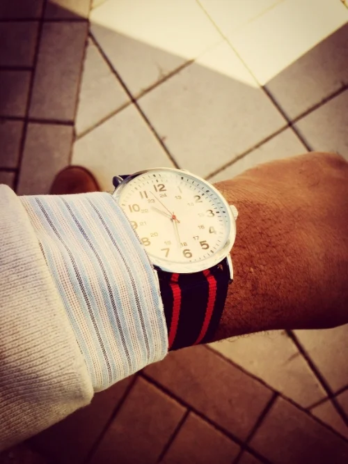

Last week I told Brian he was selfish for not thinking of others / only thinking of himself.

This week he won a $30 Target gift-card and bought himself t-shirts [prep for ETES Fourth-Grade Field Trip] and a watch for me, the gift.

While that was not my intent, I kept the gift [& gave him back the $ he spent on the watch] and used this situation as a teaching moment, the opportunity.

What I learned? Stop being an asshole.

The kid has good taste, has an affectionate nature and his love is warm. All very un-selfish qualities.

I Am

