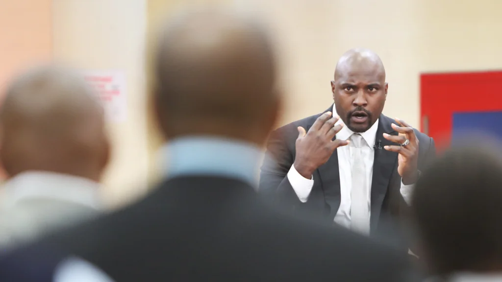

Jemele Hill hosts a roundtable discussion in featuring athletes, police & community leaders on responsibility and gun violence.



**Marcellus Wiley speaks at “An Undefeated Conversation: Athletes, Responsibility, and Violence” on August 25, 2016 at the South Side YMCA in Chicago, Illinois. Four panels made up of community members, athletes and journalist talked about the issues of gun violence, solutions and the roles that athletes have to help the solve the issues.****Brent Lewis/The Undefeated**
