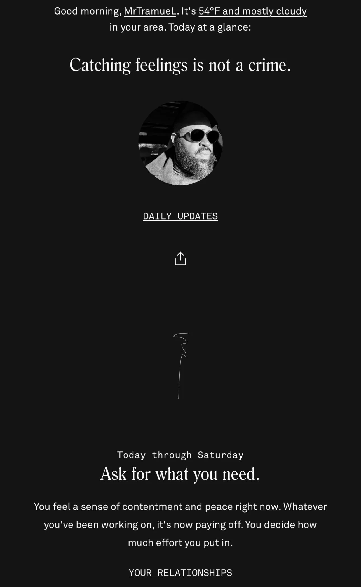
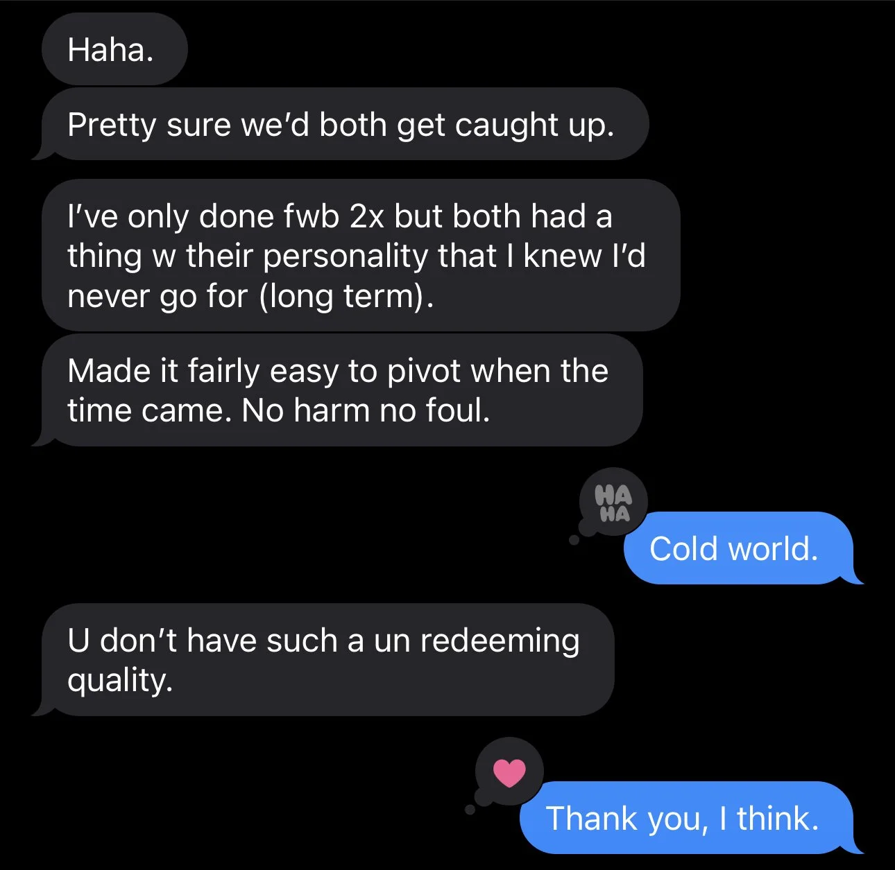

Co-Star has been on it for the past two weeks. Outside of the “for entertainment purposes only” Astrology has a direct connection to the positions, motions, and properties of the Stars’, Moons’ and shit that affect people and events here on Planet Rock.

**Science**

Catching Feelings is Not a Crime

Ask for what you need.

Most of you, the four people who read my blog, know that I’m divorced and erstwhile I was in long-term committed relationships the whole of my adult life. So dating is foreign to me and the one experience I had was a learning one. There are quite literally one billion women to zero men on Beyonce’s innanet screaming about how hard it is to date in the age of Kevin Samuel.

***“Men are not emotionally available”***

***“Men need therapy”***

It’s all relative as if women don’t.

*Detroit* was two years removed from her last relationship. As told to me… she took a year to grieve, and a year to find herself. I took her word that she was healed and ready for a long-term relationship. Null, she was anything but. I Am using to me language. A lot of her fears and unresolved issues were projected onto me.

To be fair, at the onset I understood that I wasn’t ready for a relationship, I communicated this clearly however we (& by we I mean she) continued to stay connected for over a year. I was like her dating coach; she would call me to talk about how hard it was out there in the streets. My attraction to her; style, taste, interest, communication, and values were closely aligned with mine. So I tried to switch gears, a proposition:

### **Friends With the Greatest Benefit**

I was in therapy for my own stuff and sexual healing would enhance and accelerate my personal growth. That’s what my therapist said, I didn’t say it – she said it. So, I propositioned *Detroit* with becoming friends, with the greatest benefits of all time. I got the smoothest comeback ever…

To pimp a butterfly

“U don’t have such a un redeeming quality.”

I was doing the work and my therapist was very helpful, we resolved fifty/ eleven things. I was mentally and emotionally capable of handling the benefit of friends at the greatest level.

To that point. If you’ve been seeing a therapist for more than a year and they are not giving you the tools you need to fix your life’s basic needs – find another one.

### **The Learning Experience**

She turned down my request to be the greatest of friends with benefits and a few months later presented a proposition of her own-

***“What about us?”***

Deep, deep, deep, deep, deep, deep, deep, deep, deep, deep, deep, heavy sigh.

This was the equivalent of going to a creamery for two scoops of strawberry ice cream in a waffle cone, but they were out of strawberry ice cream and only had sugar cones. We were also in the middle of the pandemic, and had only been hiking, walking, drinking wine, eating tacos, and kissing on the mouth. We were vaccinated so judge yourselves.

My response…

***“You don’t even know if you like me”***

***“We’ve never been out on a real date”***

This wasn’t an invitation, it was more of a deflection, a deterrence but I was blinded by the thought of doing relationship things-

Translation, clapping those cheeks. I too had been deprived of the pretty, round, brown. Similar interests, similar styles, and similar tastes translated into very memorable experiences, and with the first trip away together we as friends introduced the greatest benefit- shit changed soon after.

Wait a minute! Was I a bad lover?! I never considered this until right now writing this out to the four of you.

Sex complicates things. Maybe don’t do this too soon if a relationship is the goal.

When things ended. I knew I wasn’t ready for*things*. As of this writing, I am not dating. I do have one or two hangout partners and only one that I (left) the door open- She was smart and did not fall for my charm and incredibly handsome face. Also, I’m the fallback king, so I fell back on that.

And then there were none.

### **Catching Feelings is Not a Crime**

I’m alone, but I am not lonely. I have the tools necessary to date – I understand that it is not about finding a partner who is fully healed, but someone not afraid of their emotions.

The qualities I look for

- The capacity for empathy.
- Humor.
- The willingness to keep talking.
- Understands the basics of how emotions work.
- Understands the importance of establishing ground rules.

I can be selective, set higher standards because I can reciprocate anything that I ask for.

*Ask for what you need.*

*You feel a sense of contentment and peace right now. Whatever you’ve been working on, it’s now paying off. You decide how much effort you put in.*

Words man, word.

B.
