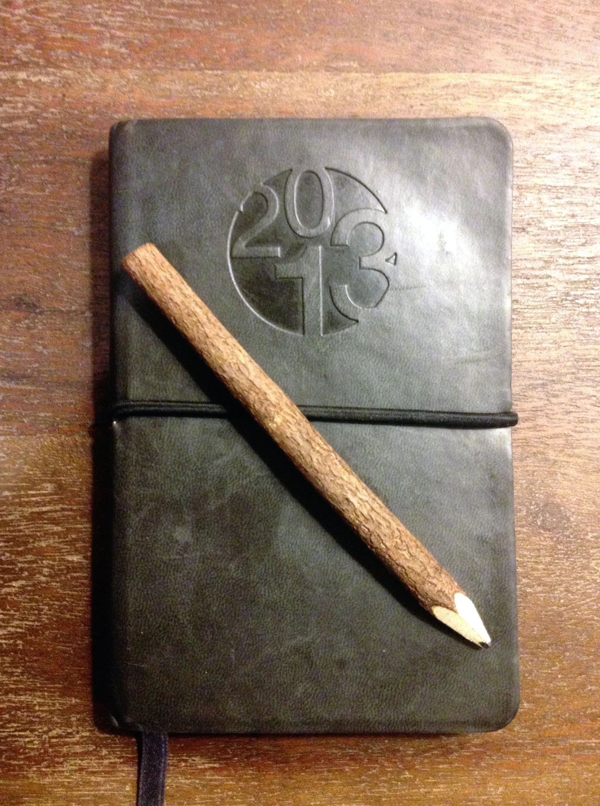

Before reading Leo Babauta’s post [12 Changes for 2014](http://zenhabits.net/12changes/) I had already begun the process of creating a “list.” Everyone has their own approach to New Year's resolution(s). In the past I’ve taken inspiration from others, tailoring their process to fit my style. I appreciate the simplicity of...

- Aim for long-term changes that will have compound interest over the years.
- Make one change at a time for maximum effectiveness.
- Find accountability to help yourself stick to the changes.
- One per month means 12 changes for the year.

“Better thinking,” was a common theme as I structured my list. Some of the items mirror those from the featured post; contentment, exercise and improve relationships.

It is never too late to do/be better.

Resolve.

I will follow the suggestion and focus on one habit a month; however I will also be mindful of the other resolutions. I believe I will be able to incorporate everything into one mindmovie. Everything flowing synergistically, enabling me to live free. Free and openly, not clinging to things that *used* to make me feel secure. As I transform, I will instill healthy living through exercise and eating in my home. I will help my kids connect with their grandparents and consciously teach them to be good stewards of "stuff" and money.

My list...

1. Improve relationships
2. Healthy living
3. Write more
4. Read more [less television]
5. Increase income
6. Increase savings
7. Find ways to stay in Love
8. Practice humility; intellectually, socially and emotionally
9. Get organized [in general but also finances, insurance & other important records]
10. Spiritual growth
11. Smile & laugh more
12. Meditate

I Am interested in your list, what are you taking into the new year? or leaving behind?

2013. Closed.

**Happy New Year!**
