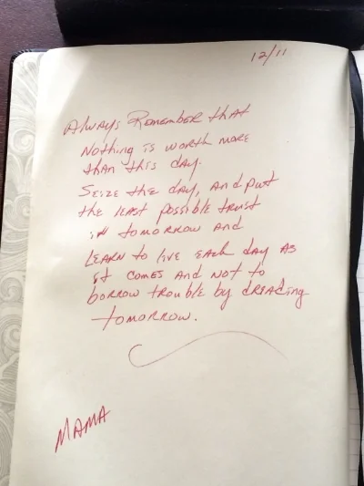

Pragmatic discussions with my mother always spark a thought. Either challenging my point of view, providing a new way of thinking or confirming my own beliefs.

> My mama be knowing.
>
> — Unknown Black Male (@MrTramueL) [March 6, 2014](https://twitter.com/MrTramueL/statuses/441611632033402881)

She spoke of her church’s theme for bible study; the pastor’s focus on a single word and each week having a letter from the word and/or a related word to provide the topic of discussion. I know how our conversation started but I don’t remember the actual word play.

### Word(s), addiction and recovery.

Her addition to the discussion was about our inner demons and unresolved emotional conflicts. She used food as an analogy, a person understands they need to loose weight but they continue to eat. Paraphrased.

### Of Challenging My Point of View

It's hard to beat something when you can't clearly see it. Especially when we don't have enough understanding or clarity about what our demons consist of.

### Of Providing a New Way of Thinking

Addiction, greed, envy, and compulsive desires are recognized as problems. These are symptoms, not the deeper problem in itself.

### Of Confirming My Own Beliefs

When the source of our attachment is brought into the light of awareness, our situation can improve dramatically.

Again, my mama be knowing.

I Am
