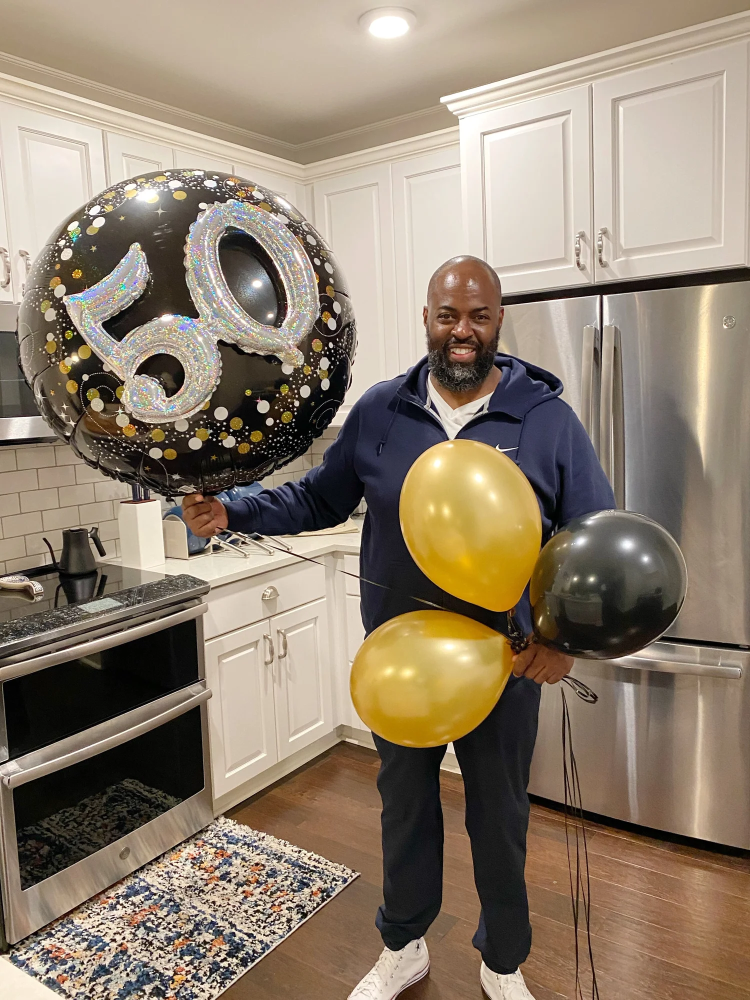

I turned 50 on September 21st, to make it memorable I took a solo excursion to Philadelphia. There are advantages to traveling alone, for me it solidifies what I believe about myself; I enjoy myself when no one else is around, I Am self-reliant, and adaptable. Additionally, the opportunity for self reflection is valuable. Without a travel partner, I can create and store my own sense of meaning from each trip. Self-reflection can be painful at times, but also fulfilling. Time alone while traveling presents an opportunity and a gift to take a careful look at yourself, your life, and your experiences.

### **“If you’re by yourself... you’re never by yourself”**

Yes Jesus was with me but also I had living souls come through and make the day special for me. I returned home with an increase in mental strength having being asked by Cat’ what words of wisdom I had for spending fifty years on Planet Earth and even more existential questions from Yvette like “What are you thinking right now?”

👀

Those questions provided the ‘time and space’ to engage in meaningful self-reflection.

## **Impractical Wisdumb**

### **The best part of advice is knowing when to give it**

When I discuss a challenge with someone, I want a person who will listen, empathize and IF ASKED, think of problem-solving ideas with me. I don’t want immediate advice without the person knowing the full information. Because I Am like this, I practice the same - Unless someone specifically ask me to problem solve - I listen and empathize.

My other responses are seemingly rooted in[**Change**](https://www.tramuel.com/iam/change/).

*Nothing is constant but change,* and we are constantly changing and transforming.

> **We don’t have to hold on to fixed views of anyone or anything — including ourselves. Just because it once was doesn’t mean it always be.**
>
> **Because, change.**
>
> **- Joel Leon**

Don’t hold on to old scripts of anything, anyone or yourself.

I remain,

B
