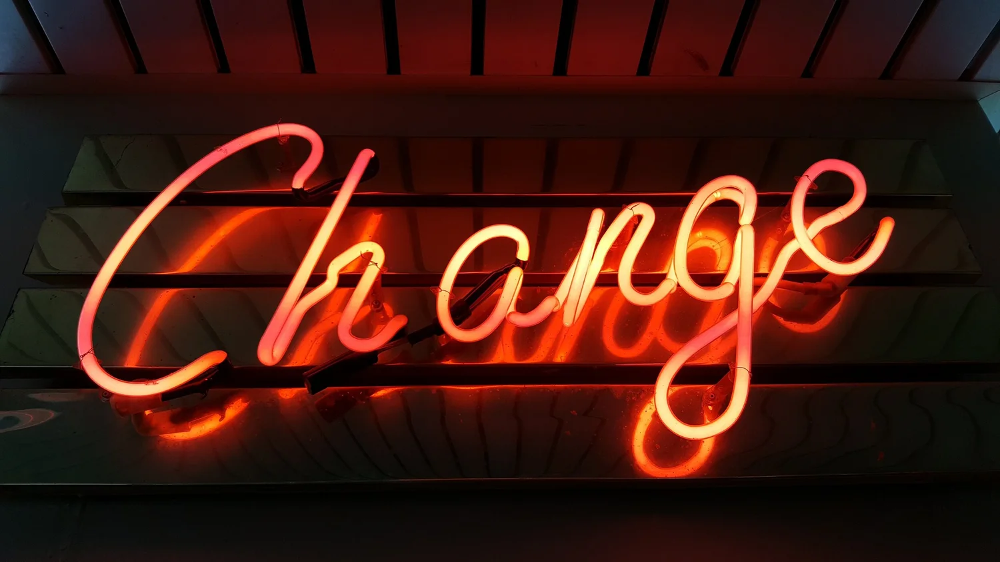

*“The most powerful word in the world pops up everywhere. Ironically, this is on Sandown Pier on the Isle of Wight (UK) — a place that has not changed for 30 years.”*

I haven't written here in this (square)space a lot although I have been writing/ journaling daily. There is and has always been an intersection where I share personal stories but not share too much of that personal story.

*GIve up conversation, but don't say nothing.*

However, writing is therapeutic for me. Mostly, masked behind giving you an opportunity and the gift. At times I become an observer who can see my psyche with objectivity and detachment.

There is a common theme happening at work and home,

# Change.

I Am a believer,

I struggle.

*"Lord, when I am wrong, make me willing to change; when I am right, make me easy to live with."*

## Problems as Opportunities and Gifts

### Of Work

Stress at work can lead to job dissatisfaction and burnout. I have never been one to complain however one who will change my circumstances. It was important for me to develop a strategy for dealing with stress that would enable me to face it healthily.

**Meditation and Breathing**

I already have in place a daily habit of meditation, that coupled with the Breathe app on Apple Watch helps me refocus attention and energy equipping me to handle stress and anxiety when they show up.

**Exercise, Food, and Sleep**

Not knowing if I would be in the office for nine hours or twelve hours it was hard to get to the gym after work, consider that at the least I'd work ten hours and there isn't much mental space left to even want to go. I changed my sleep pattern (averaging 7 hours per night) to allow for a 4:30 AM wake up time that would enable me to get to the YMCA at 5:00 AM for a workout. This energizes me for the rest of the day.

*“The more we do, the more we can do.”*

Also, I gave up ginger ale and juice and only drink water and my daily (one) cup of coffee. As for food, I didn't have a bad diet, I simply ate too much — I’ve been making better choices and eating smaller portions.

### Of Home

I said, *“I’m not who you think I am.”*

She said, *“I’ll be damned if you think it changes you.”*

Those words are made up, but it is representative of how people will hold onto (and hold against you) the slightest misdemeanors that occurred years ago. Things are often out of your control, and can not be easily fixed, at least not right away. In the past this would have led me to excessive eating and depression but recognizing my triggers - The opportunity here is to accept my emotional vulnerability.

> Sometimes they try to break you,
>
> But just be good to your heart.
>
> Sometimes they try to change you,
>
> Don’t let them tear you apart.

I like cool days, cold brewed coffee, clear blue skies, new socks and clean underwear; these B' good days. Problems vex me because they show me just how vulnerable I Am without new socks. I kid but seriously, I love new socks. Also, I have come to realize that every problem points to an opportunity and a gift. God uses those opportunities to correct us, some gifts can only be recieved in the darkness, through pain and failure.

I Remain,

B
